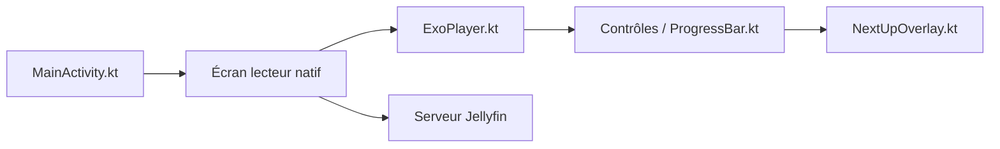

# DonutWare/Fladder

> Cross-platform Jellyfin client in Flutter, for anyone consuming their self-hosted media library.

## The problem
The official Jellyfin clients do not cover all devices equally well.

## What it actually does
Direct, transcoded or offline playback, multiple profiles, intro skipping, trickplay, comic reading (.cbz, .cbr), sync and downloads, Seerr/Jellyseerr integration. On Android, a native ExoPlayer player is driven from Flutter. Android, TV, Web, macOS, Windows, iOS, Linux.

## How it is wired


## Trying it
```bash
docker pull ghcr.io/donutware/fladder:latest
```

## Cost and gotchas
Free, but requires a Jellyfin server. The web build hosted on GitHub only accepts https. Windows Defender may report false positives.

## What it is not
Not a media server: only a client.

## Alternatives
No alternative named in the README.

## For you
Ignore: media client unrelated to data/AI, only of interest if you use Jellyfin.
