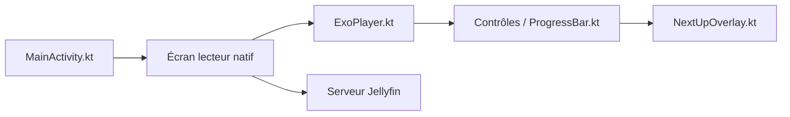

# DonutWare/Fladder

> Client Jellyfin multiplateforme en Flutter, pour qui consomme sa médiathèque auto-hébergée.

## Le problème
Les clients Jellyfin officiels ne couvrent pas tous les appareils de la même façon.

## Ce que ça fait vraiment
Lecture directe, transcodée ou hors ligne, profils multiples, saut d'intros, trickplay, lecture de BD (.cbz, .cbr), synchronisation et téléchargements, intégration Seerr/Jellyseerr. Sur Android, un lecteur natif ExoPlayer est piloté depuis Flutter. Android, TV, Web, macOS, Windows, iOS, Linux.

## Comment c'est branché


## Essayer
```bash
docker pull ghcr.io/donutware/fladder:latest
```

## Coût et pièges
Gratuit, mais exige un serveur Jellyfin. Le build web hébergé sur GitHub n'accepte que https. Windows Defender peut signaler des faux positifs.

## Ce que ce n'est pas
Pas un serveur multimédia : seulement un client.

## Alternatives
Aucune alternative nommée dans le README.

## Pour toi
À ignorer : client média sans rapport avec data/IA, intéressant seulement si tu utilises Jellyfin.

