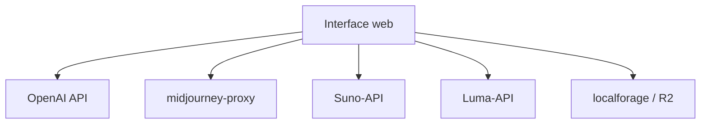

# Dooy/chatgpt-web-midjourney-proxy

> Web interface unifying ChatGPT, Midjourney, Suno, Luma, Runway and other generative services.

## The problem
Each generative service (image, music, video) has its own interface and API. Driving Midjourney, Suno, Luma from a single front end means rewiring everything.

## What it actually does
Fork of ChatGPT-web adding Midjourney (text-to-image, variations, upscale, remix, InsightFace face-swap), Suno/udio (music), pika/kling/runway/luma (video), ideogram/flux/dall-e (image), OpenAI realtime, TTS/whisper. All the original ChatGPT-web features, customizable key/base_url, local image storage, brute-force protection. Uses midjourney-proxy, Suno-API, Luma-API as backends.

## How it is wired


## Trying it
```bash
docker run --name chatgpt-web-midjourney-proxy -d -p 6015:3002 \
-e OPENAI_API_KEY=sk-xxxxx \
-e OPENAI_API_BASE_URL=https://api.openai.com \
-e MJ_SERVER=https://your-mj-server:6013 \
-e MJ_API_SECRET=your-mj-api-secret ydlhero/chatgpt-web-midjourney-proxy
```

## Cost and gotchas
All API keys (OpenAI, MJ, Suno, Luma…) are at your expense, plus recommended third-party relay services. Depends on several SaaS and unofficial proxies.

## What it is not
Not a model provider: a facade that calls third-party APIs and proxies. Neither official nor affiliated with OpenAI/Midjourney.

## Alternatives
- ChenZhaoYu/chatgpt-web: the original project, without the media integrations.

## For you
Outside the professional data/AI scope: aimed at mainstream creative use, multiple third-party dependencies — ignore.
