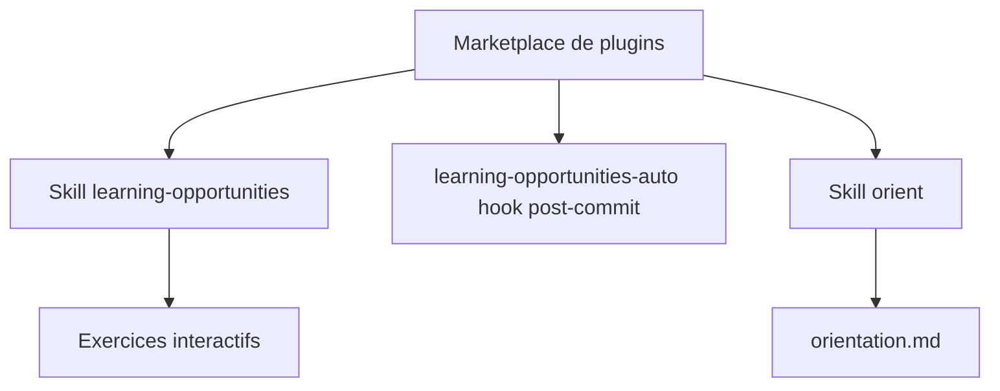

# DrCatHicks/learning-opportunities

> Claude Code and Codex skill that offers learning exercises after architecture work.

## The problem
Coding with an agent gives an illusion of understanding and reduces the active practice that makes knowledge stick.

## What it actually does
After significant work (new files, schema, refactoring), Claude offers a 10 to 15 minute exercise: prediction, generation, retrieval from memory, explaining aloud. Claude must wait for your answer instead of supplying it. At most two exercises per session, none after a refusal. An optional post-commit hook and the `orient` skill produce an `orientation.md` file.

## How it is wired
Simplified diagram based on the sheet, no diagram provided.



## Trying it
```bash
/plugin marketplace add https://github.com/DrCatHicks/learning-opportunities.git
/plugin install learning-opportunities@learning-opportunities
/plugin install orient@learning-opportunities
/orient
/learning-opportunities orient
codex plugin marketplace add https://github.com/DrCatHicks/learning-opportunities.git
```

## Cost and gotchas
Free, CC-BY-4.0. Uses session time and agent tokens. The README admits that Claude's default behavior may resist.

## What it is not
Not a course: exercises generated on your own code. Effectiveness is not measured in this README, which only mentions evaluation leads.

## Alternatives
For learning goals: the companion Learning-Goal skill, named in the README.

## For you
Keep an eye on it: a useful remedy against skill loss with coding agents, to test on a real project before imposing it.
