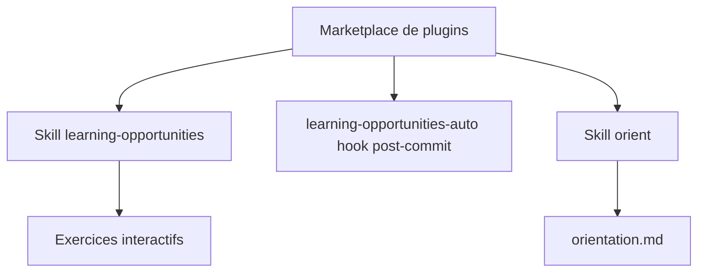

# DrCatHicks/learning-opportunities

> Compétence Claude Code et Codex proposant des exercices d'apprentissage après un travail d'architecture.

## Le problème
Coder avec un agent donne l'illusion de comprendre et réduit la pratique active qui fixe les connaissances.

## Ce que ça fait vraiment
Après un travail important (nouveaux fichiers, schéma, refactorisation), Claude propose un exercice de 10 à 15 minutes : prédiction, génération, retrait de mémoire, explication à voix haute. Claude doit attendre la réponse au lieu de la fournir. Maximum de deux exercices par session, aucun après un refus. Un hook optionnel après commit et la compétence `orient` produisent un fichier `orientation.md`.

## Comment c'est branché
Schéma simplifié d'après la fiche, sans diagramme fourni.



## Essayer
```bash
/plugin marketplace add https://github.com/DrCatHicks/learning-opportunities.git
/plugin install learning-opportunities@learning-opportunities
/plugin install orient@learning-opportunities
/orient
/learning-opportunities orient
codex plugin marketplace add https://github.com/DrCatHicks/learning-opportunities.git
```

## Coût et pièges
Gratuit, CC-BY-4.0. Consomme du temps de session et des jetons de l'agent. Le README admet que le comportement par défaut de Claude peut résister.

## Ce que ce n'est pas
Pas un cours : des exercices générés sur ton propre code. L'efficacité n'est pas mesurée dans ce README, qui parle de pistes d'évaluation.

## Alternatives
Pour les objectifs d'apprentissage : la compétence compagnonne Learning-Goal, nommée dans le README.

## Pour toi
À surveiller : correctif utile contre la perte de compétence avec les agents de code, à tester sur un projet réel avant de l'imposer.

