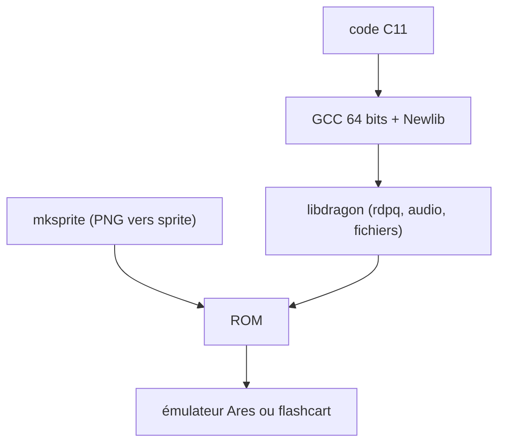

# DragonMinded/libdragon

> Free SDK for programming the Nintendo 64 console in C, with a modern GCC toolchain.

## The problem
The N64's official tools are proprietary and dated; enthusiasts need a modern toolchain.

## What it actually does
64-bit GCC and Newlib toolchain, RDP library (rdpq), accelerated audio mixer (WAV, Opus, XM, YM), file system on ROM and SD card, compression (LZ4, Aplib, Shrinkler), dynamic libraries and symbolized error screens. The preview branch adds 3D, MPEG1 video and threads. The repository is marked archived on GitHub.

## How it is wired


## Trying it
```bash
# Aucune commande dans le README : installation de la toolchain
# décrite dans le guide d'installation (conteneur Docker disponible).
```

## Cost and gotchas
Free. Hardware or the Ares emulator (Vulkan GPU) required. Archived repository: further development goes through other branches or repositories, to be checked.

## What it is not
Not a game engine. Not compatible with libultra. The preview may break the API.

## Alternatives
No alternative named in the README.

## For you
Ignore: N64 game programming is outside your scope and the repository is archived.
