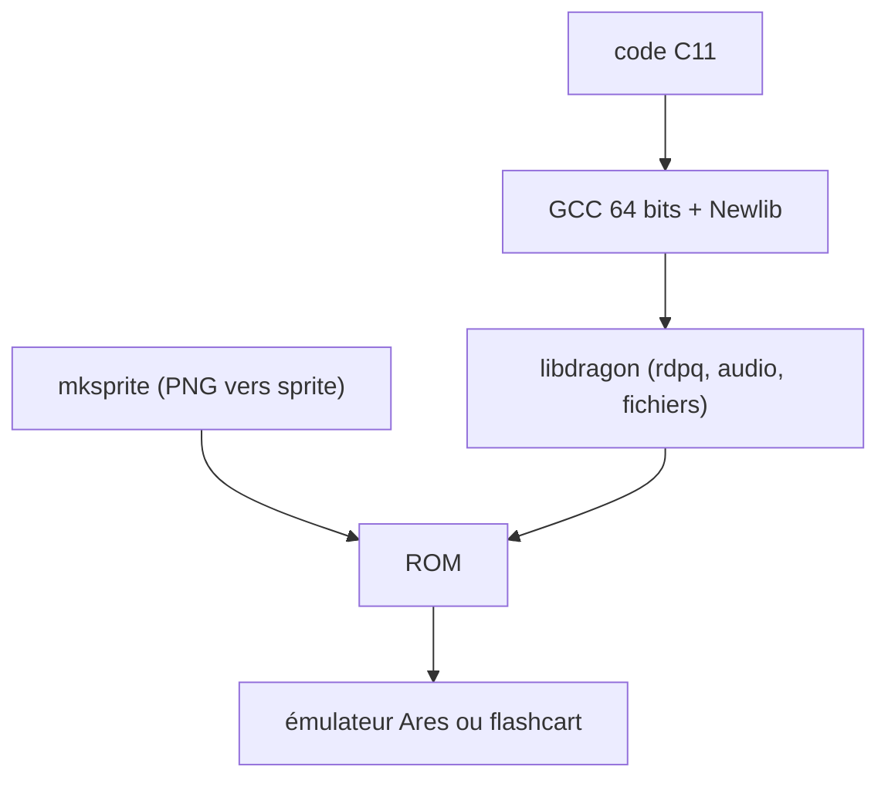

# DragonMinded/libdragon

> SDK libre pour programmer en C la console Nintendo 64, avec toolchain GCC moderne.

## Le problème
Les outils officiels de la N64 sont propriétaires et datés ; les passionnés ont besoin d'une chaîne moderne.

## Ce que ça fait vraiment
Toolchain GCC et Newlib 64 bits, bibliothèque RDP (rdpq), mixeur audio accéléré (WAV, Opus, XM, YM), système de fichiers en ROM et sur carte SD, compression (LZ4, Aplib, Shrinkler), bibliothèques dynamiques et écrans d'erreur symbolisés. La branche preview ajoute 3D, vidéo MPEG1 et threads. Le dépôt est marqué archivé sur GitHub.

## Comment c'est branché


## Essayer
```bash
# Aucune commande dans le README : installation de la toolchain
# décrite dans le guide d'installation (conteneur Docker disponible).
```

## Coût et pièges
Gratuit. Matériel ou émulateur Ares (GPU Vulkan) nécessaire. Dépôt archivé : les évolutions passent par d'autres branches ou dépôts, à vérifier.

## Ce que ce n'est pas
Pas un moteur de jeu. Pas compatible avec libultra. La preview peut casser l'API.

## Alternatives
Aucune alternative nommée dans le README.

## Pour toi
À ignorer : programmation de jeux N64 hors de ton périmètre et dépôt archivé.

