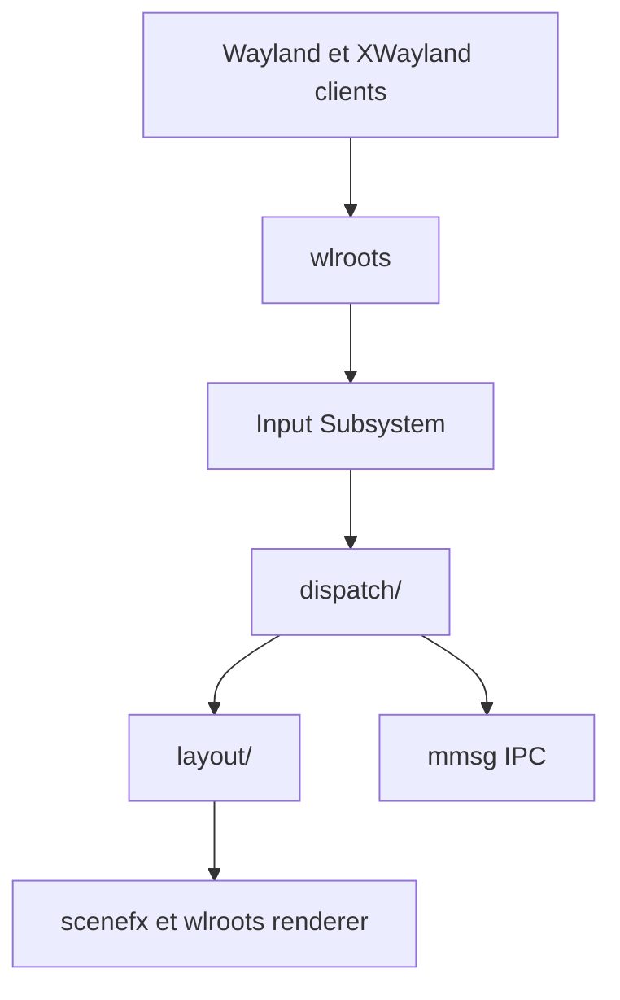

# DreamMaoMao/mangowc

> Lightweight Wayland compositor written in C, based on wlroots, for Linux users who want a tag-based desktop.

## The problem
Wayland window managers are either heavy, or poor in animations, effects and XWayland support.

## What it actually does
It manages Wayland and X11 windows with tags rather than workspaces, several layouts (scroller, master stack, monocle, dwindle) and animations. Effects (blur, shadows, rounded corners) go through scenefx. The configuration reloads live and an IPC (mmsg) lets you drive it from outside.

## How it is wired


## Trying it
```bash
yay -S mangowm-git
git clone https://github.com/DreamMaoMao/mango-config.git ~/.config/mango
```

## Cost and gotchas
Free. The documented installation targets Arch Linux (AUR); other distributions are pointed to the guide. A license is present but GitHub does not identify it. The README lists many dependencies for the author's own configuration.

## What it is not
Not a full desktop environment: bar, launcher and screen lock are tools to add. Pull requests generated directly by AI are refused by the project's policy.

## Alternatives
No alternative named in the README.

## For you
Ignore: a Linux window manager brings nothing to data or MLOps work, unless you are precisely looking to change desktop.
