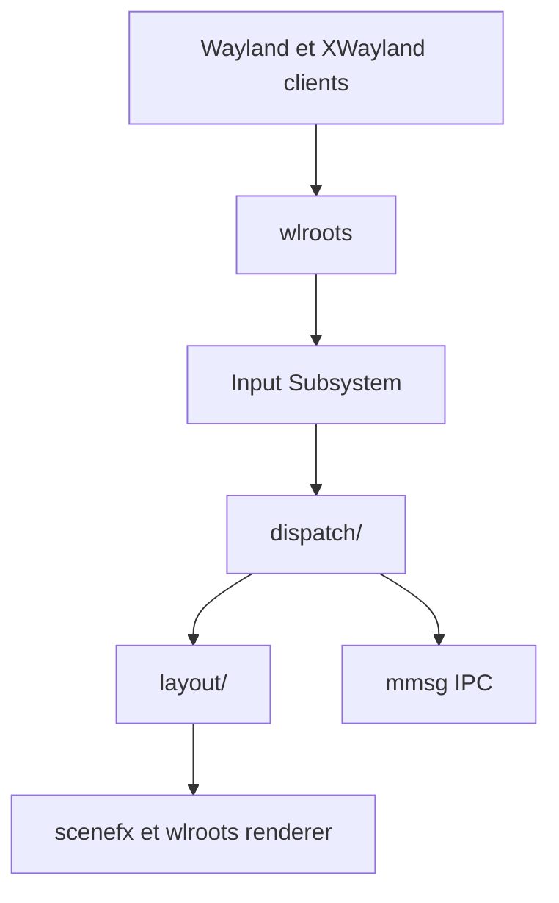

# DreamMaoMao/mangowc

> Compositeur Wayland léger en C, basé sur wlroots, pour utilisateurs Linux qui veulent un bureau à tags.

## Le problème
Les gestionnaires de fenêtres Wayland sont soit lourds, soit pauvres en animations, en effets et en support XWayland.

## Ce que ça fait vraiment
Il gère les fenêtres Wayland et X11 avec des tags plutôt que des espaces de travail, plusieurs dispositions (scroller, pile maître, monocle, dwindle) et des animations. Les effets (flou, ombres, coins arrondis) passent par scenefx. La configuration se recharge à chaud et un IPC (mmsg) permet de le piloter depuis l'extérieur.

## Comment c'est branché


## Essayer
```bash
yay -S mangowm-git
git clone https://github.com/DreamMaoMao/mango-config.git ~/.config/mango
```

## Coût et pièges
Gratuit. L'installation documentée vise Arch Linux (AUR) ; les autres distributions renvoient au guide. La licence est présente mais GitHub ne l'identifie pas. Le README liste de nombreuses dépendances pour la configuration de l'auteur.

## Ce que ce n'est pas
Pas un environnement de bureau complet : barre, lanceur et verrouillage sont des outils à ajouter. Les PR générées directement par IA sont refusées par la politique du projet.

## Alternatives
Aucune alternative nommée dans le README.

## Pour toi
À ignorer : un gestionnaire de fenêtres Linux n'apporte rien à un travail data ou MLOps, sauf si tu cherches justement à changer de bureau.

