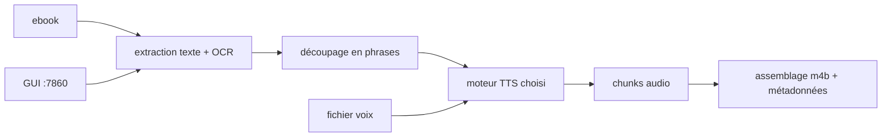

# DrewThomasson/ebook2audiobook

> Converts an e-book into a chaptered audiobook, with optional voice cloning.

## The problem
Commercial audiobooks cover only a fraction of books, and never your own documents.
Gluing a TTS engine onto an EPUB by hand gives a file with no chapters or metadata.

## What it actually does
Reads epub, mobi, azw3, pdf, docx, html, odt and even images via OCR, and outputs m4b, mp3, flac, wav, ogg.
Switches between XTTSv2, Bark, Fairseq, VITS, Tacotron2, Tortoise, GlowTTS, YourTTS and Piper depending on the language.
Accepts a 1 to 5 minute voice file for cloning, and SML tags `[break]`, `[pause:N]`, `[voice:...]`.
Runs as a Gradio interface on `localhost:7860` or in scriptable `--headless` mode.

## How it is wired


## Trying it
```bash
git clone https://github.com/DrewThomasson/ebook2audiobook.git
cd ebook2audiobook
./ebook2audiobook.command --headless --ebook <path_to_ebook_file> --language eng
```
On Windows, `ebook2audiobook.cmd`. In a container: image `athomasson2/ebook2audiobook:cpu` with the volumes
`./ebooks`, `./audiobooks`, `./models`, `./voices`, `./tmp` and port 7860.

## Cost and gotchas
2 GB of RAM and 1 GB of VRAM at minimum, 8 GB / 4 GB recommended; the README warns that modern engines
are very slow on CPU. Under Docker, MPS is not exposed: Apple Silicon falls back to CPU.

## What it is not
Not a tool to circumvent DRM: the README limits use to legally acquired, unprotected books.
Not a smart splitter: since EPUB has no standard notion of a chapter, you have to clean the text by hand.
Not stable across all languages: sentence splitting is explicitly flagged as needing refinement.

## Alternatives
`E2A-SML`: companion repository by the same authors to place SML tags automatically.
The engines listed as not yet integrated (GPT-SoVITS, F5-TTS, Kokoro-TTS, chatterbox) remain direct options.

## For you
A good multi-engine TTS sandbox; keep it for personal use, the quality depends too much on the language/engine pair.
