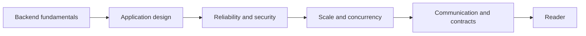

# DsThakurRawat/Backend-from-first-Principle

> Course notes on backend development, from HTTP basics to advanced topics, for learners.

## The problem
Backend concepts (HTTP, routing, databases, security) are scattered and rarely explained from first principles.

## What it actually does
A repository of Markdown chapters with Go and Python examples, served as an installable PWA site, readable offline. The table of contents covers HTTP/CORS, routing, serialization, authentication, validation, databases, background jobs, observability, scaling, WebSockets, OpenAPI, gRPC, full-text search. The README does not detail the chapter contents, and some topics have no matching folder.

## How it is wired


## Trying it
```bash
npm install
npm run desktop
```

## Cost and gotchas
Free. No license declared: reuse of the content is not permitted as it stands. Requires a Chromium browser for the application mode.

## What it is not
Not a library or a framework. No guarantee of completeness: the README mentions topics with no folder.

## Alternatives
No alternative named in the README.

## For you
Ignore: general educational content without a license, loosely related to the data/AI scope; to be consulted read-only.
