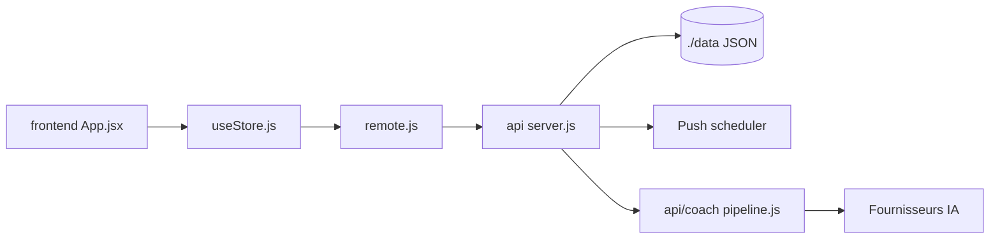

# DuarteSantos8/openGym

> Self-hosted weightlifting and body-weight tracker with passkey login, for athletes who want their data at home.

## The problem
Workout apps keep your data behind a remote account, push subscriptions and vanish with the startup.

## What it actually does
React PWA with a weekly plan across 1,324 exercises, guided sessions, timer, rule-based progression, estimated 1RM, statistics and muscle maps. The framework-free Node API stores data in JSON files under `./data`, authenticates with WebAuthn passkeys and sends push notifications. Import from FitNotes, Strong and Hevy. An optional AI coach and a read-only MCP server exist.

## How it is wired


## Trying it
```bash
git clone https://github.com/DuarteSantos8/openGym
cd openGym
cp .env.example .env
docker compose pull
docker compose up -d
```

## Cost and gotchas
Free. The AI coach, optional, uses your own key (Anthropic, OpenAI, Gemini or a compatible endpoint). Exercise media (~140 MB) are downloaded from a third-party repository, and their rights are disputed according to the README.

## What it is not
Not an App Store mobile app: APK to sideload yourself, no iOS download. AGPL-3.0: obligations if you host a modified version.

## Alternatives
Hevy, Strong or FitNotes, cited as import sources.

## For you
Ignore: fitness tracking unrelated to a data/AI/MLOps profile, despite careful design.
