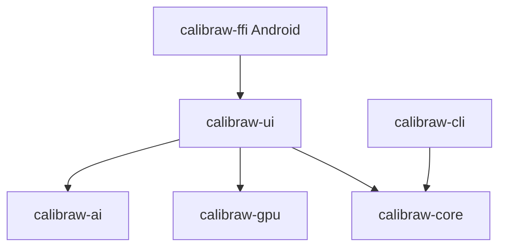

# Duecki1/CalibRaw

> Free RAW photo editor for Linux, Android, Windows and macOS, with local AI.

## The problem
Developing RAW files without a subscription or account, with AI masks that run on your own machine.

## What it actually does
Rust editor (`wgpu`, WGSL shaders, `egui` interface): curves, color mixer, grading, masks, Bayer and X-Trans demosaicing, HDR merge, focus stacking. Local AI via ONNX Runtime (BiRefNet, SAM 2.1, LaMa, RawNIND) does masks, object removal and denoising. Non-destructive edits stored in `.calibraw` files.

## How it is wired


## Trying it
```bash
git clone https://github.com/Duecki1/CalibRaw.git
cd CalibRaw
cargo run -p calibraw-ui --bin calibraw --release
calibraw-develop-export --input photo.ARW --output photo.jxl
```

## Cost and gotchas
Requires a GPU with Vulkan, Direct3D 12 or Metal (no OpenGL; lavapipe on CPU, slow). Build: Rust 1.92+, libclang, cmake. AI models downloaded after consent. License GPL-3.0.

## What it is not
Not a general-purpose batch processing tool (the CLI only exports). Not a cloud service.

## Alternatives
darktable and RapidRAW, cited in the README.

## For you
Keep an eye on it: a nice example of a local ONNX pipeline on GPU, but it is photography, not MLOps.
