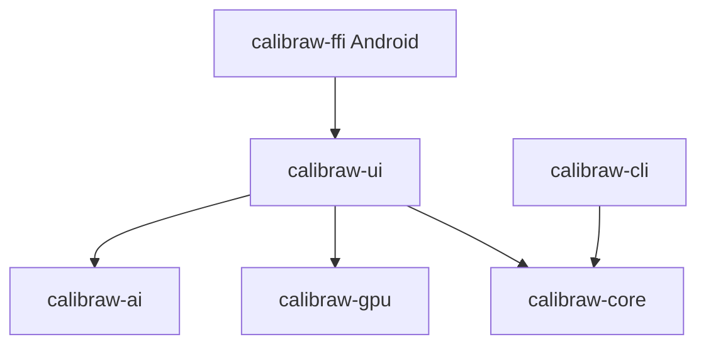

# Duecki1/CalibRaw

> Éditeur photo RAW libre pour Linux, Android, Windows et macOS, avec IA locale.

## Le problème
Développer des RAW sans abonnement ni compte, avec masques IA qui tournent sur sa machine.

## Ce que ça fait vraiment
Éditeur Rust (`wgpu`, shaders WGSL, interface `egui`) : courbes, mélangeur de couleurs, étalonnage, masques, dématriçage Bayer et X-Trans, fusion HDR, focus stacking. L'IA locale via ONNX Runtime (BiRefNet, SAM 2.1, LaMa, RawNIND) fait masques, suppression d'objets et débruitage. Retouches non destructives dans des fichiers `.calibraw`.

## Comment c'est branché


## Essayer
```bash
git clone https://github.com/Duecki1/CalibRaw.git
cd CalibRaw
cargo run -p calibraw-ui --bin calibraw --release
calibraw-develop-export --input photo.ARW --output photo.jxl
```

## Coût et pièges
Exige un GPU avec Vulkan, Direct3D 12 ou Metal (pas d'OpenGL ; lavapipe en CPU, lent). Compilation : Rust 1.92+, libclang, cmake. Modèles IA téléchargés après accord. Licence GPL-3.0.

## Ce que ce n'est pas
Pas un outil de traitement par lot généraliste (le CLI exporte seulement). Pas un service cloud.

## Alternatives
darktable et RapidRAW, cités dans le README.

## Pour toi
Surveiller : bel exemple de pipeline ONNX local sur GPU, mais c'est de la photo, pas du MLOps.

