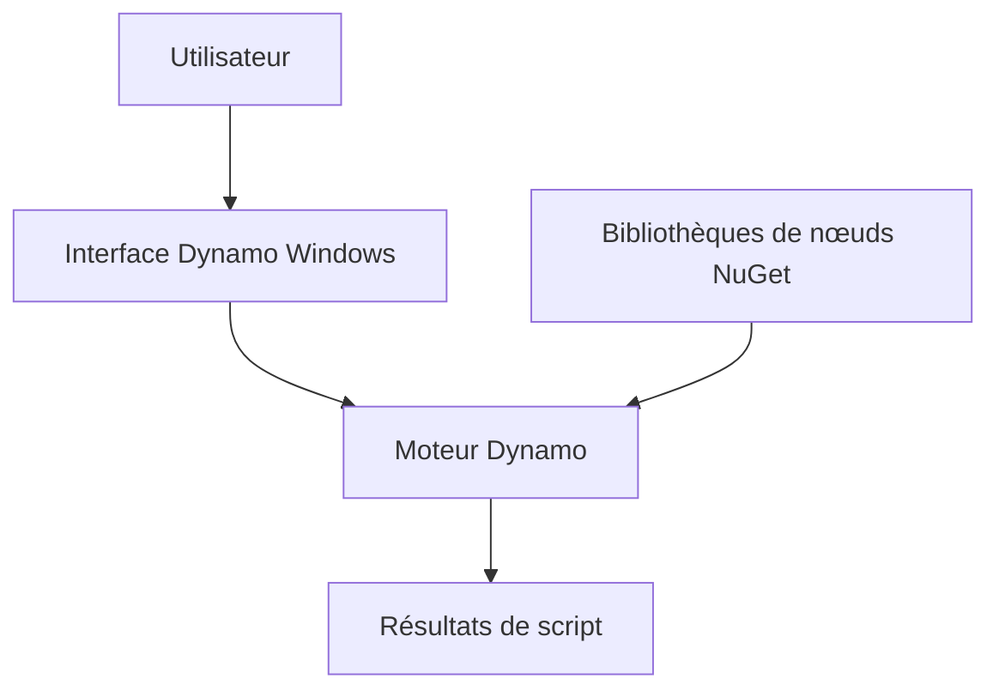

# DynamoDS/Dynamo

> Visual node-based programming tool, for users with or without code, originating from Autodesk.

## The problem
Scripting design behaviors without writing conventional code is hard for non-programmers.

## What it actually does
A visual graph editor where you define logic and custom blocks, with text languages possible. Node libraries are written via NuGet packages. The interface is Windows only, the engine can be built elsewhere.

## How it is wired
Simplified diagram based on the sheet, no diagram provided.



## Trying it
No command in the README: build with Visual Studio 2022 and the .NET 10 SDK, or download from dynamobim.org.
```bash
# non documenté dans le README
```

## Cost and gotchas
Visual Studio 2022, .NET 10 SDK and Node.js to build. An opt-in Autodesk instrumentation collects usage data.

## What it is not
Not cross-platform on the interface side. Not data-science oriented.

## Alternatives
No alternative named in the README.

## For you
Ignore: a Windows visual design tool, far from your daily data/AI work.
