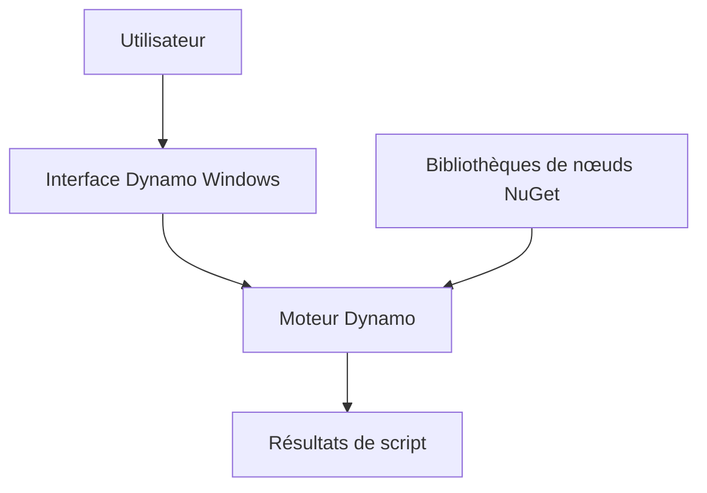

# DynamoDS/Dynamo

> Outil de programmation visuelle par nœuds, pour utilisateurs avec ou sans code, issu d'Autodesk.

## Le problème
Scripter des comportements de conception sans écrire de code classique est difficile pour les non-programmeurs.

## Ce que ça fait vraiment
Un éditeur de graphes visuels où l'on définit de la logique et des blocs personnalisés, avec langages textuels possibles. Des bibliothèques de nœuds s'écrivent via les paquets NuGet. L'interface est Windows seulement, le moteur peut être compilé ailleurs.

## Comment c'est branché
Schéma simplifié d'après la fiche, sans diagramme fourni.



## Essayer
Aucune commande dans le README : compiler avec Visual Studio 2022 et le SDK .NET 10, ou télécharger sur dynamobim.org.
```bash
# non documenté dans le README
```

## Coût et pièges
Visual Studio 2022, .NET 10 SDK et Node.js pour compiler. Une instrumentation Autodesk opt-in collecte des données d'usage.

## Ce que ce n'est pas
Pas multiplateforme côté interface. Pas orienté data science.

## Alternatives
Aucune alternative nommée dans le README.

## Pour toi
À ignorer : outil de conception visuelle Windows, loin de ton quotidien data/IA.

