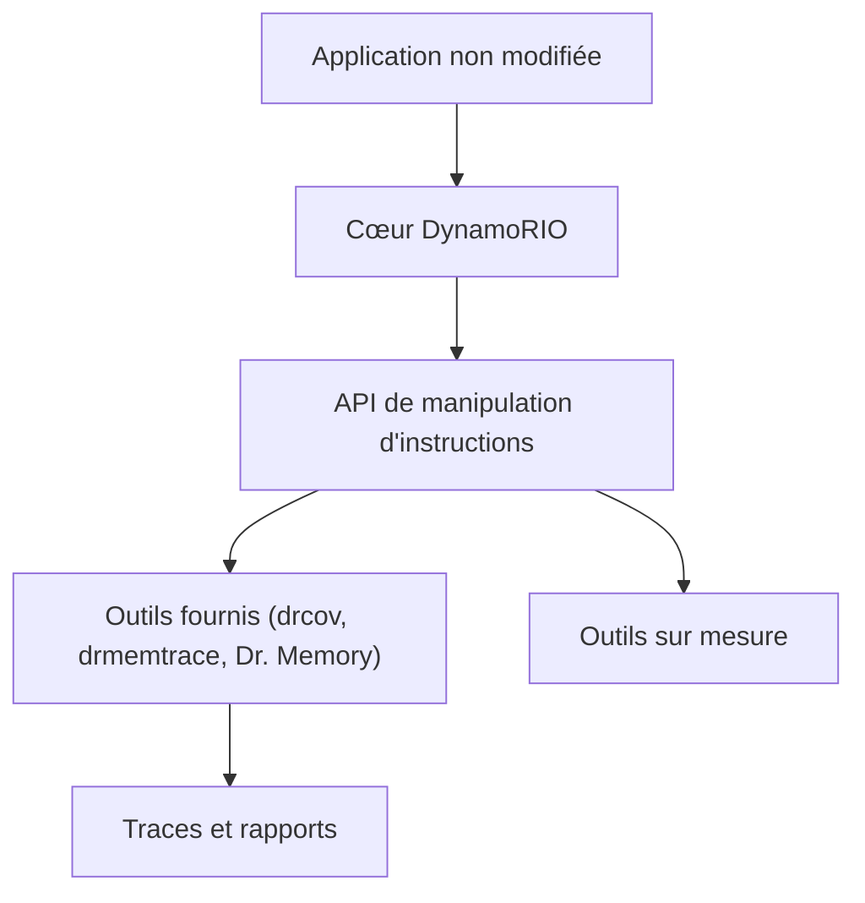

# DynamoRIO/dynamorio

> Runtime code manipulation system for building analysis, profiling and instrumentation tools.

## The problem
Analyzing or modifying an already compiled program, without its sources, requires intercepting its instructions while it runs.

## What it actually does
Provides an API to read and arbitrarily rewrite the instructions of unmodified applications on Windows, Linux and Android (x86, AMD64, ARM, AArch64). The package includes ready-made tools: Dr. Memory, drcachesim (cache simulator), drcov (coverage), drstrace, drltrace, inscount, Dr. Fuzz. Mac OSX support is in progress.

## How it is wired
Simplified diagram based on the sheet, no diagram provided.

## Trying it
No command documented in the README: a binary package for Windows and Linux can be downloaded from the project website, the API documentation is in the package.

## Cost and gotchas
Free. License present but not identified by GitHub; the README describes it as mainly BSD. 1,832 open issues.

## What it is not
Not a graphical debugger nor a turnkey tool: it is a framework for building tools in C.

## Alternatives
None cited; the README lists tools built on top of it (WinAFL, DrCCTProf, GWPSan).

## For you
Ignore: low-level binary instrumentation, very far from a data / AI pipeline.
