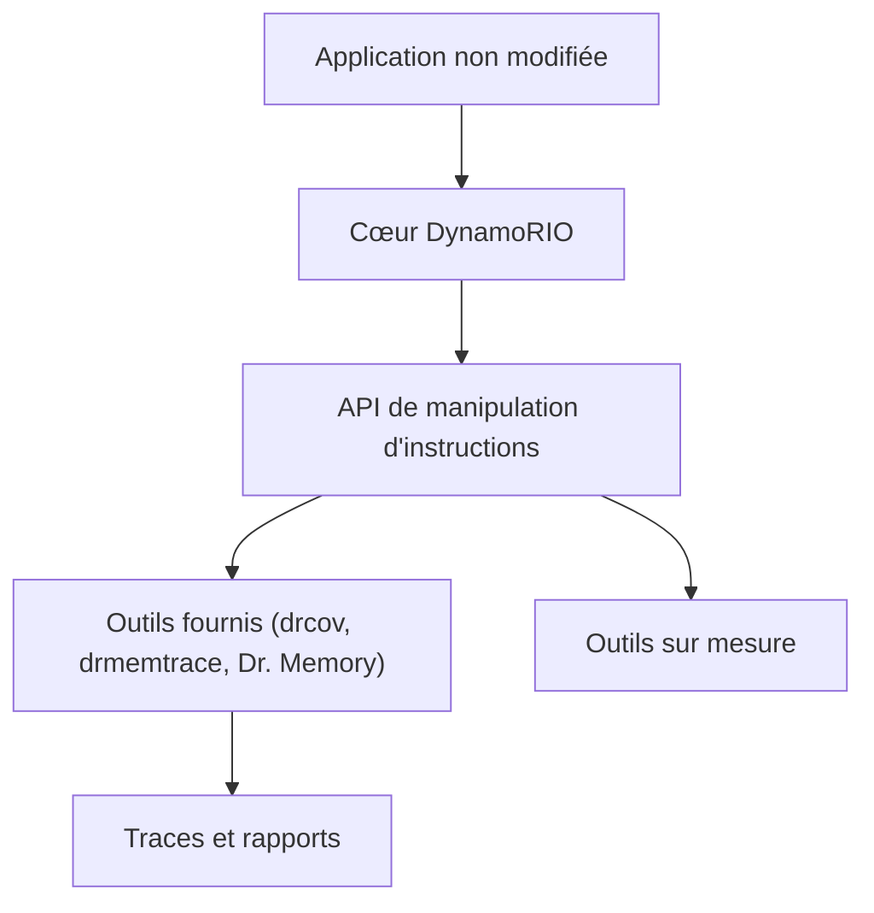

# DynamoRIO/dynamorio

> Système de manipulation de code à l'exécution pour bâtir des outils d'analyse, de profilage et d'instrumentation.

## Le problème
Analyser ou modifier un programme déjà compilé, sans ses sources, exige d'intercepter ses instructions pendant qu'il tourne.

## Ce que ça fait vraiment
Fournit une API pour lire et réécrire arbitrairement les instructions d'applications non modifiées sur Windows, Linux et Android (x86, AMD64, ARM, AArch64). Le paquet inclut des outils prêts : Dr. Memory, drcachesim (simulateur de cache), drcov (couverture), drstrace, drltrace, inscount, Dr. Fuzz. Le support Mac OSX est en cours.

## Comment c'est branché
Schéma simplifié d'après la fiche, sans diagramme fourni.

## Essayer
Aucune commande documentée dans le README : un paquet binaire Windows et Linux est téléchargeable sur le site du projet, la documentation de l'API est dans le paquet.

## Coût et pièges
Gratuit. Licence présente mais non identifiée par GitHub ; le README la décrit comme principalement BSD. 1 832 issues ouvertes.

## Ce que ce n'est pas
Pas un débogueur graphique ni un outil clé en main : c'est un cadre pour construire des outils en C.

## Alternatives
Aucune alternative citée ; le README liste des outils construits dessus (WinAFL, DrCCTProf, GWPSan).

## Pour toi
Ignorer : instrumentation binaire de bas niveau, très loin d'un pipeline data / IA.

