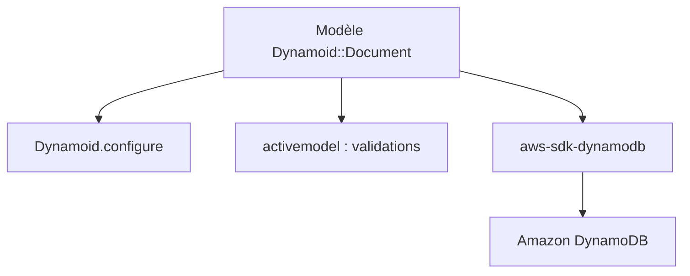

# Dynamoid/dynamoid

> Ruby ORM for Amazon DynamoDB, with an ActiveRecord-like API, for Rails developers.

## The problem
Working with DynamoDB through the raw AWS SDK is verbose and far from the habits of an ActiveRecord model.

## What it actually does
You declare models with `include Dynamoid::Document` and typed fields. The library provides queries (`where`), associations, callbacks, validations, optimistic locking, additional types (DateTime, Time) and DynamoDB transactions. It relies on `aws-sdk-dynamodb` and `activemodel`.

## How it is wired


## Trying it
```bash
bundle add dynamoid
# ou
gem install dynamoid
```

## Cost and gotchas
You need an AWS account and credentials (access_key, secret_key, region); DynamoDB is billed by usage. Ruby >= 2.3 and Rails >= 4.2 are announced as compatible.

## What it is not
Not a multi-database ORM: it targets DynamoDB only. It is not a Python client nor an analytical data tool.

## Alternatives
- Mongoid: the ORM Dynamoid takes inspiration from, for MongoDB.

## For you
Ignore: a Ruby ORM for DynamoDB is only useful if you maintain a Rails application on AWS.
