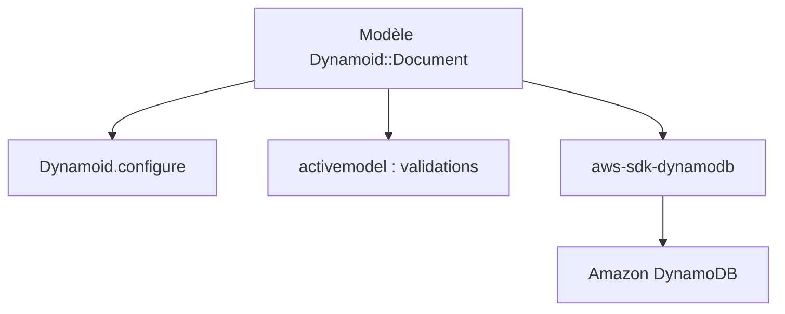

# Dynamoid/dynamoid

> ORM Ruby pour Amazon DynamoDB, avec une API proche d'ActiveRecord, pour développeurs Rails.

## Le problème
Manipuler DynamoDB via le SDK AWS brut est verbeux, loin des habitudes d'un modèle ActiveRecord.

## Ce que ça fait vraiment
On déclare des modèles avec `include Dynamoid::Document` et des champs typés. La bibliothèque fournit requêtes (`where`), associations, callbacks, validations, verrouillage optimiste, types additionnels (DateTime, Time) et transactions DynamoDB. Elle s'appuie sur `aws-sdk-dynamodb` et `activemodel`.

## Comment c'est branché


## Essayer
```bash
bundle add dynamoid
# ou
gem install dynamoid
```

## Coût et pièges
Il faut un compte AWS et des identifiants (access_key, secret_key, region) ; DynamoDB est facturé à l'usage. Ruby >= 2.3 et Rails >= 4.2 sont annoncés comme compatibles.

## Ce que ce n'est pas
Pas un ORM multi-bases : il cible uniquement DynamoDB. Ce n'est pas un client Python ni un outil de données analytique.

## Alternatives
- Mongoid : l'ORM dont Dynamoid s'inspire, pour MongoDB.

## Pour toi
Ignorer : un ORM Ruby pour DynamoDB ne sert que si tu maintiens une application Rails sur AWS.

