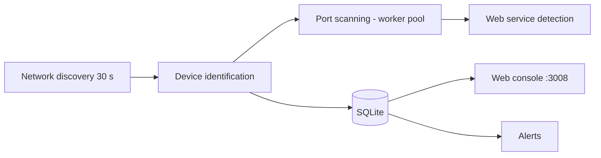

# Dyneteq/reconya

> Go tool for discovering and monitoring devices on a local network, with a web console.

## The problem
Knowing which devices, ports and services are present on your network takes several tools.

## What it actually does
Native IPv4 sweep (ICMP, TCP, ARP), passive IPv6 monitoring, identification (MAC, vendor, hostname, OS fingerprint), scan of the 100 common ports with banners, web service detection with screenshots, alerts (new device, risky port, duplicate MAC) and topology. SQLite database, Go-template interface. No outbound calls by default: four external lookups must be enabled.

## How it is wired


## Trying it
```bash
curl -sL https://raw.githubusercontent.com/Dyneteq/reconya/master/install.sh | sh
cd reconya && sudo ./reconya-*
make install
make start
```

## Cost and gotchas
Free. Requires root rights for ICMP. Default credentials `admin` / `password` to change in `.env`. Docker discouraged (unreliable MAC access). Web fonts come from Google Fonts. The license is to be checked.

## What it is not
Not an attack tool, but a scanner that generates active traffic: use it only on a network you are authorized to scan. The `curl | sh` script should be read before running.

## Alternatives
None named in the README.

## For you
Worth watching: useful for inventorying a home network or a lab; no direct link with data/AI.
