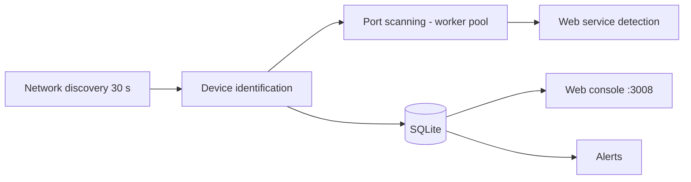

# Dyneteq/reconya

> Outil Go de découverte et de surveillance des appareils d'un réseau local, avec console web.

## Le problème
Savoir quels appareils, ports et services sont présents sur son réseau demande plusieurs outils.

## Ce que ça fait vraiment
Balayage IPv4 natif (ICMP, TCP, ARP), surveillance IPv6 passive, identification (MAC, constructeur, nom d'hôte, empreinte d'OS), scan des 100 ports courants avec bannières, détection des services web avec captures d'écran, alertes (nouvel appareil, port risqué, MAC dupliquée) et topologie. Base SQLite, interface en gabarits Go. Aucun appel sortant par défaut : quatre recherches externes sont à activer.

## Comment c'est branché


## Essayer
```bash
curl -sL https://raw.githubusercontent.com/Dyneteq/reconya/master/install.sh | sh
cd reconya && sudo ./reconya-*
make install
make start
```

## Coût et pièges
Gratuit. Exige les droits root pour l'ICMP. Identifiants par défaut `admin` / `password` à changer dans `.env`. Docker déconseillé (accès MAC peu fiable). Les polices web viennent de Google Fonts. La licence est à vérifier.

## Ce que ce n'est pas
Pas un outil d'attaque, mais un scanner qui génère du trafic actif : à n'utiliser que sur un réseau dont tu as l'autorisation. Le script `curl | sh` est à lire avant exécution.

## Alternatives
Aucune nommée dans le README.

## Pour toi
Surveiller : utile pour inventorier un réseau domestique ou un labo ; sans lien direct avec data/IA.

