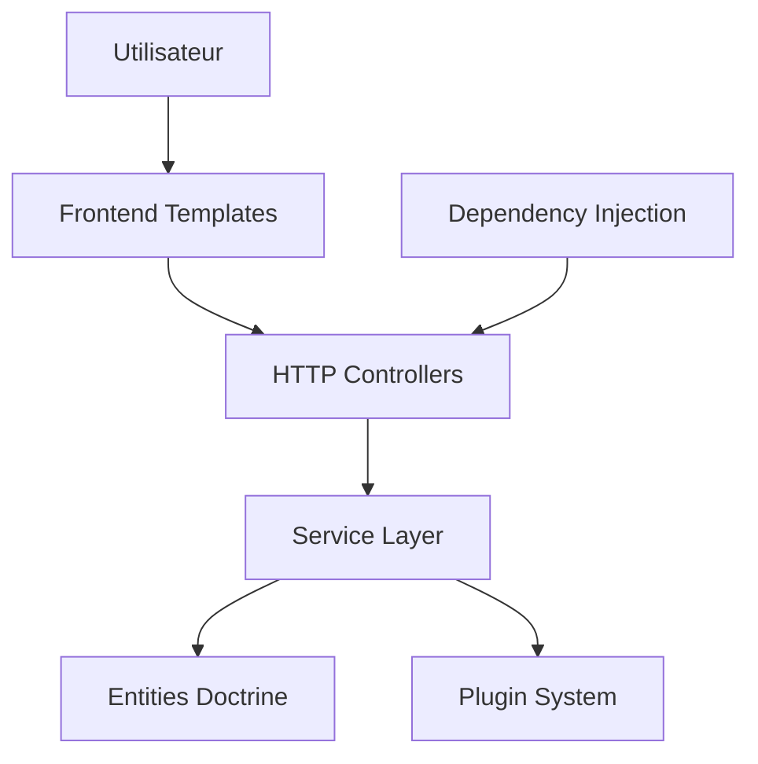

# EC-CUBE/ec-cube

> Japanese open-source e-commerce platform in PHP and Symfony, for online shops in the local market.

## The problem
Setting up an online shop that complies with Japanese taxation (reduced tax rate, points, multiple shipments).

## What it actually does
A Symfony 7.4 application with Doctrine, Twig and Bootstrap: catalog, cart, orders, payment, customers, administration and a plugin system with a marketplace. It handles the Japanese reduced tax rate, a points system and several delivery addresses per order. The README claims more than 35,000 shops.

## How it is wired
Diagram based on the one drawn from the code.


## Trying it
```bash
git clone https://github.com/EC-CUBE/ec-cube.git
cd ec-cube
docker compose -f docker-compose.yml -f docker-compose.pgsql.yml up -d
composer create-project ec-cube/ec-cube ec-cube "4.4.x-dev" --keep-vcs
bin/console eccube:install
```

## Cost and gotchas
Free. It requires PHP 8.2 to 8.5, Apache with mod_rewrite and mod_ssl, and PostgreSQL or MySQL 8.4, or Docker. The need for PHP is not in the list of prerequisites. The README is mostly in Japanese. The license is not identified by GitHub.

## What it is not
It is not an international solution: it is designed for the Japanese market. The architecture described by the diagram tool mentions version 4.3, while the README targets 4.4.

## Alternatives
Not documented in the README.

## For you
Ignore: a Japan-centered PHP shop has no link to your data / AI / MLOps work.
