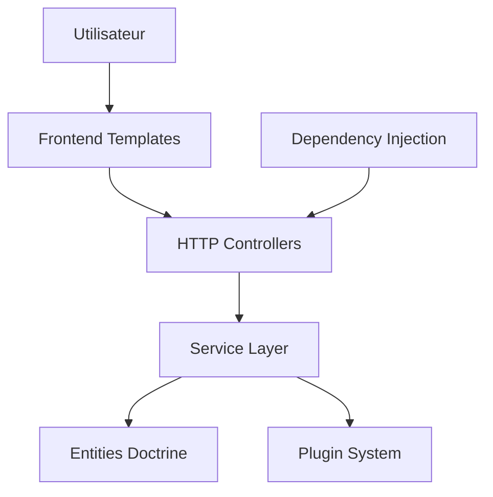

# EC-CUBE/ec-cube

> Plateforme de e-commerce open source japonaise en PHP et Symfony, pour boutiques en ligne du marché local.

## Le problème
Monter une boutique en ligne conforme à la fiscalité japonaise (taxe réduite, points, expéditions multiples).

## Ce que ça fait vraiment
Application Symfony 7.4 avec Doctrine, Twig et Bootstrap : catalogue, panier, commandes, paiement, clients, administration et système de plugins avec place de marché. Elle gère la taxe réduite japonaise, un système de points et plusieurs adresses de livraison par commande. Le README annonce plus de 35 000 boutiques.

## Comment c'est branché
Schéma d'après le diagramme tiré du code.


## Essayer
```bash
git clone https://github.com/EC-CUBE/ec-cube.git
cd ec-cube
docker compose -f docker-compose.yml -f docker-compose.pgsql.yml up -d
composer create-project ec-cube/ec-cube ec-cube "4.4.x-dev" --keep-vcs
bin/console eccube:install
```

## Coût et pièges
Gratuit. Il faut PHP 8.2 à 8.5, Apache avec mod_rewrite et mod_ssl, et PostgreSQL ou MySQL 8.4, ou Docker. Le besoin de PHP n'existe pas dans la liste des prérequis. Le README est surtout en japonais. La licence n'est pas identifiée par GitHub.

## Ce que ce n'est pas
Ce n'est pas une solution internationale : elle est conçue pour le marché japonais. L'architecture décrite par l'outil de diagramme mentionne la version 4.3, alors que le README vise la 4.4.

## Alternatives
Non documenté dans le README.

## Pour toi
À ignorer : une boutique PHP centrée sur le Japon n'a aucun lien avec tes travaux data / IA / MLOps.

