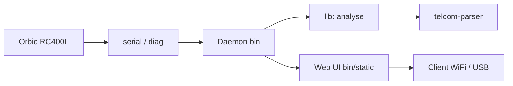

# EFForg/rayhunter

> IMSI catcher (stingray) detector that runs on an Orbic mobile hotspot, for the general public and activists.

## The problem
Cell-site simulators monitor phones without the user seeing anything.

## What it actually does
A Rust daemon runs on the device, reads the modem's diagnostic interface, analyzes LTE messages (`telcom-parser` crate) and flags suspicious behavior. A web interface, served by the daemon, controls the recordings. The README stresses ease of installation and reduced false positives.

## How it is wired

## Trying it
No command in the README: it points to the installation guide.

## Cost and gotchas
The software is free, but you must buy the compatible device. Legal warning: legal risk to be assessed outside the United States.

## What it is not
Not a guarantee of detection: it is not a shield, and the README acknowledges possible false positives.

## Alternatives
No alternative named in the README.

## For you
Ignore: hardware telecom security, unrelated to data/AI/MLOps.
