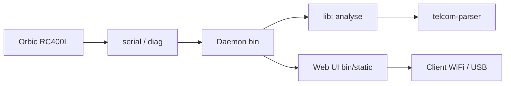

# EFForg/rayhunter

> Détecteur d'IMSI catchers (stingrays) qui tourne sur un hotspot mobile Orbic, pour grand public et militants.

## Le problème
Les simulateurs d'antennes-relais surveillent les téléphones sans que l'utilisateur ne voie rien.

## Ce que ça fait vraiment
Un démon Rust tourne sur l'appareil, lit l'interface de diagnostic du modem, analyse les messages LTE (crate `telcom-parser`) et signale les comportements suspects. Une interface web, servie par le démon, commande les enregistrements. Le README insiste sur la facilité d'installation et la réduction des faux positifs.

## Comment c'est branché

## Essayer
Aucune commande dans le README : renvoi vers le guide d'installation.

## Coût et pièges
Logiciel gratuit, mais il faut acheter l'appareil compatible. Avertissement légal : risque juridique à évaluer hors des États-Unis.

## Ce que ce n'est pas
Pas une garantie de détection : ce n'est pas un bouclier, et le README reconnaît des faux positifs possibles.

## Alternatives
Aucune alternative nommée dans le README.

## Pour toi
À ignorer : sécurité télécom matérielle, sans rapport avec data/IA/MLOps.

