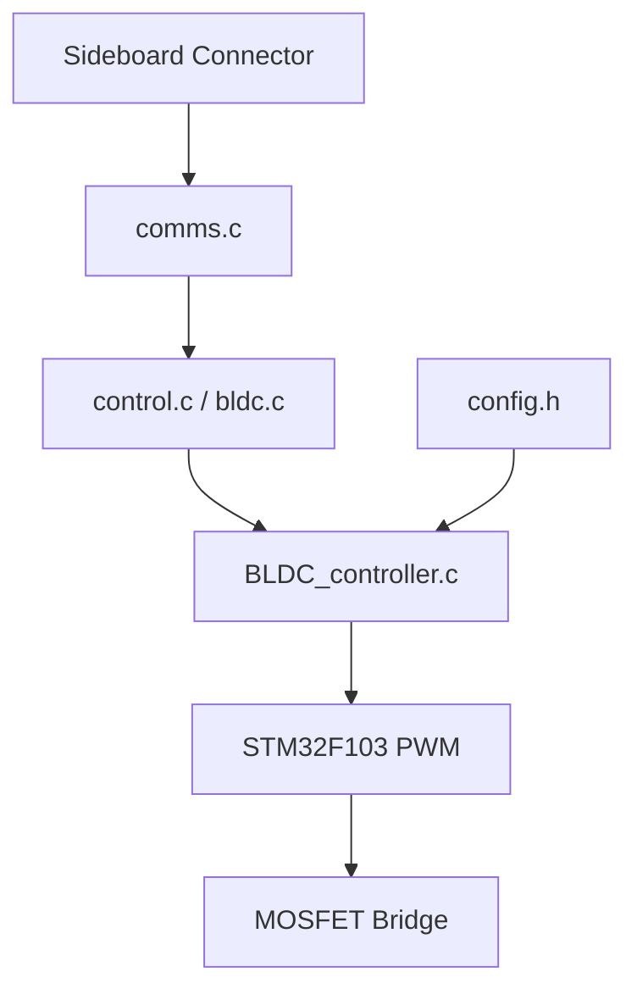

# EFeru/hoverboard-firmware-hack-FOC

> STM32 firmware that replaces a hoverboard's control with field-oriented control (FOC), for tinkerers and roboticists.

## The problem
A hoverboard's original firmware commutates the motors noisily and inefficiently, with no control modes usable in robotics.

## What it actually does
It implements three control types (commutation, sinusoidal, FOC) with three FOC modes: voltage, speed, torque. It protects with maximum speed and current limits, offers field weakening (disabled by default) and ten input variants: potentiometers, serial, PPM, PWM, iBUS, Nunchuk, pedals, etc. It targets STM32F103 or GD32F103 boards.

## How it is wired

## Trying it
No command is given in the README; it points to the wiki (Getting Started). The control choice is made in `config.h` (CTRL_TYP_SEL, CTRL_MOD_REQ).

## Cost and gotchas
You need a hoverboard, a programmer and a build toolchain (Makefile, PlatformIO or MDK-ARM). The README warns: very fast motors, risk of overvoltage on the BMS.

## What it is not
Not software: it is embedded firmware. The self-balancing controller for hoverboards is not implemented.

## Alternatives
The README cites the original firmware lucysrausch/hoverboard-firmware-hack and bipropellant.

## For you
Ignore: embedded electronics, outside the data / AI / MLOps scope, unless you have a personal robotics project.
