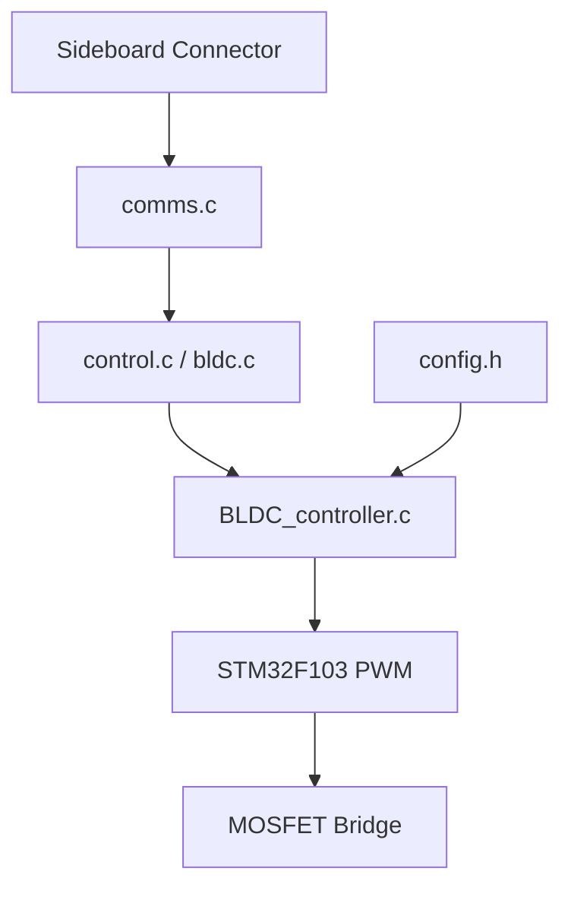

# EFeru/hoverboard-firmware-hack-FOC

> Firmware STM32 qui remplace la commande d'un hoverboard par une commande vectorielle (FOC), pour bricoleurs et roboticiens.

## Le problème
Le firmware d'origine d'un hoverboard commute les moteurs de façon bruyante et peu efficace, sans modes de contrôle exploitables en robotique.

## Ce que ça fait vraiment
Il implémente trois types de contrôle (commutation, sinusoïdal, FOC) avec trois modes FOC : tension, vitesse, couple. Il protège en vitesse et courant maximum, propose l'affaiblissement de champ (désactivé par défaut) et dix variantes d'entrée : potentiomètres, série, PPM, PWM, iBUS, Nunchuk, pédales, etc. Il vise les cartes STM32F103 ou GD32F103.

## Comment c'est branché

## Essayer
Aucune commande n'est donnée dans le README ; il renvoie au wiki (Getting Started). Le choix du contrôle se fait dans `config.h` (CTRL_TYP_SEL, CTRL_MOD_REQ).

## Coût et pièges
Il faut un hoverboard, un programmateur et une chaîne de compilation (Makefile, PlatformIO ou MDK-ARM). Le README met en garde : moteurs très rapides, risque de surtension sur la BMS.

## Ce que ce n'est pas
Ce n'est pas un logiciel : c'est du firmware embarqué. Le contrôleur d'équilibre pour hoverboard n'est pas implémenté.

## Alternatives
Le README cite le firmware d'origine lucysrausch/hoverboard-firmware-hack et bipropellant.

## Pour toi
À ignorer : électronique embarquée, hors du périmètre data / IA / MLOps, sauf projet de robotique personnel.

