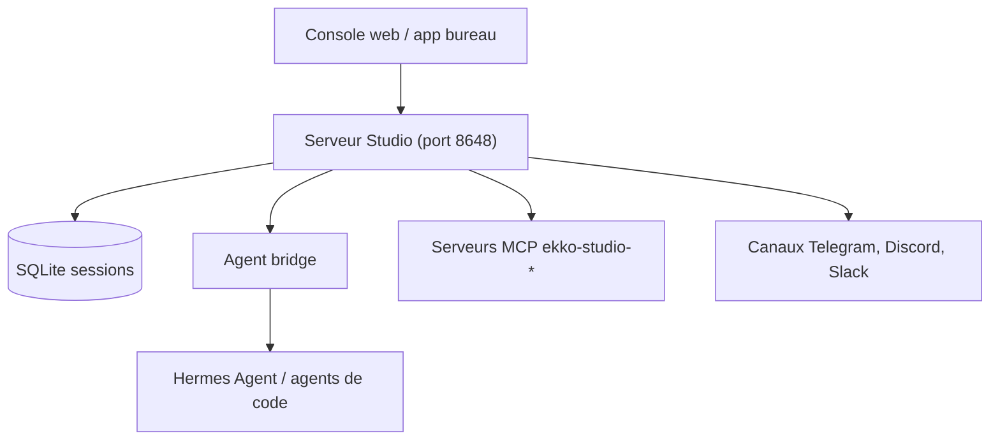

# EKKOLearnAI/hermes-studio

> Local workspace to chat with several AI agents, code and chain visual workflows.

## The problem
Driving several coding and chat agents from separate interfaces, with no shared history or automation.

## What it actually does
Web console or desktop app that connects agents (Hermes, Ekko, 14 listed coding agents): streaming chat, group rooms, visual workflows with approvals, file explorer, web terminal, 10 messaging channels, voice. Sessions stored in local SQLite. The project used to be called Hermes Studio / Hermes Web UI.

## How it is wired


## Trying it
```bash
npm install -g ekko-studio && ekko-studio-web start
# puis http://localhost:8648 (Node.js 23 ou plus)
WEBUI_IMAGE=ekkoye8888/hermes-web-ui docker compose up -d
# puis http://localhost:6060
```

## Cost and gotchas
Model provider keys are on you. Default credentials `admin` / `123456`, and it listens on `0.0.0.0` by default: change both right away.

## What it is not
Not a model nor a single agent: a control surface. The README provided is truncated, the rest is not verified. License present but not identified.

## Alternatives
- The legacy package `hermes-web-ui`: same versions, old name.

## For you
Watch: very rich for orchestrating agents locally, but a wide surface, unclear license and weak default credentials.
