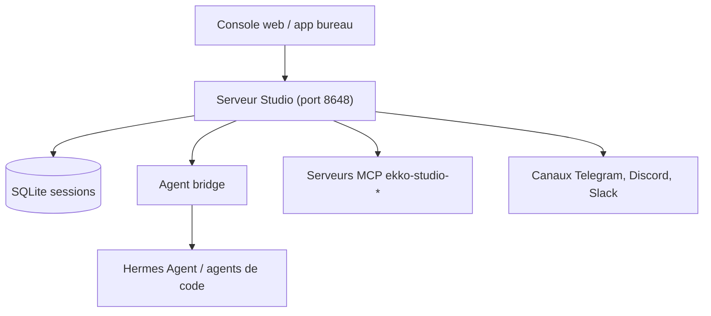

# EKKOLearnAI/hermes-studio

> Espace de travail local pour discuter avec plusieurs agents IA, coder et enchaîner des workflows visuels.

## Le problème
Piloter plusieurs agents de code et de chat depuis des interfaces séparées, sans historique ni automatisation communs.

## Ce que ça fait vraiment
Console web ou app de bureau qui relie des agents (Hermes, Ekko, 14 agents de code listés) : chat en streaming, salons de groupe, workflows visuels avec approbations, explorateur de fichiers, terminal web, 10 canaux de messagerie, voix. Sessions stockées en SQLite local. Le projet s'appelait Hermes Studio / Hermes Web UI.

## Comment c'est branché


## Essayer
```bash
npm install -g ekko-studio && ekko-studio-web start
# puis http://localhost:8648 (Node.js 23 ou plus)
WEBUI_IMAGE=ekkoye8888/hermes-web-ui docker compose up -d
# puis http://localhost:6060
```

## Coût et pièges
Les clés des fournisseurs de modèles sont à ta charge. Identifiants par défaut `admin` / `123456`, et écoute sur `0.0.0.0` par défaut : à changer tout de suite.

## Ce que ce n'est pas
Pas un modèle ni un agent seul : une surface de pilotage. Le README fourni est tronqué, le reste n'est pas vérifié. Licence présente mais non identifiée.

## Alternatives
- Le paquet hérité `hermes-web-ui` : mêmes versions, ancien nom.

## Pour toi
Surveiller : très riche pour orchestrer des agents en local, mais surface large, licence floue et identifiants par défaut faibles.

