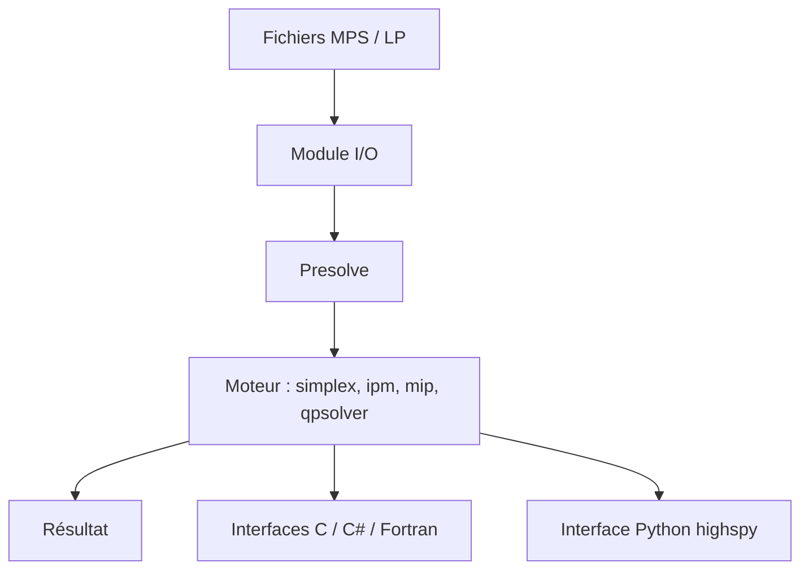

# ERGO-Code/HiGHS

> Linear, quadratic and integer optimization solver, with C, Python, C# and Fortran interfaces.

## The problem
Solving large optimization problems (planning, allocation) without a commercial solver license.

## What it actually does
Solves LPs, convex QPs and sparse MIPs, using primal/dual simplex, interior point and branch-and-bound. Reads MPS and LP files on the command line. The Python package `highspy` is a thin wrapper. No third-party dependency is required.

## How it is wired


## Trying it
```bash
pip install highspy
highs ml.mps
cmake -S . -B build
cmake --build build
```

## Cost and gotchas
Free (MIT). The `*-apache` binaries include HiPO under the Apache license; Meson and Nix are community-provided, with no official support.

## What it is not
Not a modeling language: you describe the model via MPS, LP or an API. No GPU required.

## Alternatives
No alternative named in the README.

## For you
Adopt: `pip install highspy` gives you a mature, MIT-licensed LP/MIP solver, useful in operations research and resource optimization.
