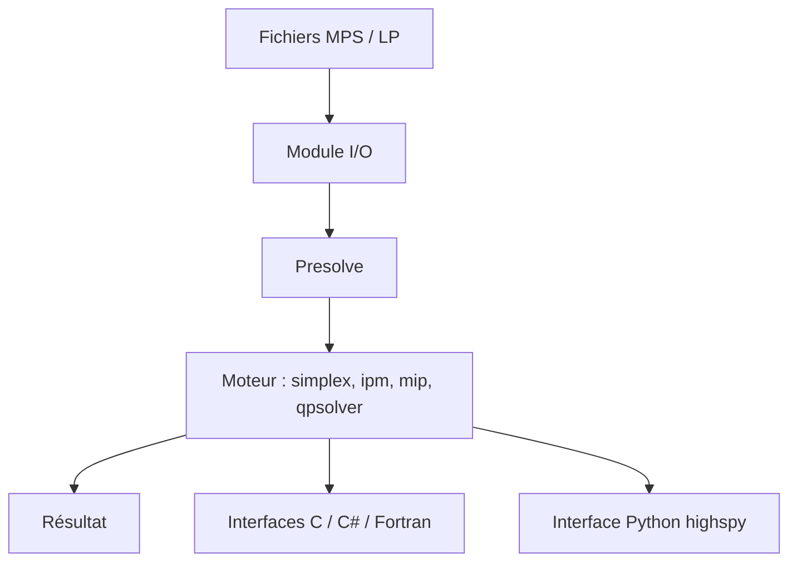

# ERGO-Code/HiGHS

> Solveur d'optimisation linéaire, quadratique et en nombres entiers, avec interfaces C, Python, C# et Fortran.

## Le problème
Résoudre de grands problèmes d'optimisation (planification, allocation) sans licence de solveur commercial.

## Ce que ça fait vraiment
Résout des LP, des QP convexes et des MIP creux, par simplexe primal/dual, point intérieur et branch-and-bound. Lit les fichiers MPS et LP en ligne de commande. Le paquet Python `highspy` est un mince wrapper. Aucune dépendance tierce n'est requise.

## Comment c'est branché


## Essayer
```bash
pip install highspy
highs ml.mps
cmake -S . -B build
cmake --build build
```

## Coût et pièges
Gratuit (MIT). Les binaires `*-apache` incluent HiPO sous licence Apache ; Meson et Nix sont fournis par la communauté, sans support officiel.

## Ce que ce n'est pas
Pas un langage de modélisation : on décrit le modèle via MPS, LP ou une API. Pas de GPU requis.

## Alternatives
Aucune alternative nommée dans le README.

## Pour toi
À adopter : `pip install highspy` donne un solveur LP/MIP MIT, mature, utile en recherche opérationnelle et en optimisation de ressources.

