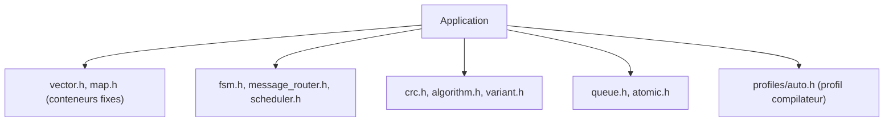

# ETLCPP/etl

> C++ header-only library of fixed-size containers, with no dynamic allocation, for embedded systems.

## The problem
STL containers allocate on the heap, which is discouraged or forbidden on a microcontroller.

## What it actually does
Containers with capacity fixed at compile time and an API close to the STL, plus utilities: state machines, message routing, scheduler, timers, CRC, variants. Compatible with C++03 and later, with C++11 and later features backported. More than 10,000 unit tests are claimed.

## How it is wired


## Trying it
```bash
git clone https://github.com/ETLCPP/etl.git
cd etl
git checkout <targetVersion>
cmake -B build .
cmake --install build/
```

## Cost and gotchas
Free, MIT. Some interfaces must be implemented per project (the clocks of `chrono.h`, `etl_putchar` for `print.h`). An `etl_profile.h` file tunes the library.

## What it is not
Not a full replacement for the STL. Not useful in data science or classic MLOps; the author is looking for Keil, IAR and DSP testers.

## Alternatives
Not documented in the README, which positions itself only against the STL.

## For you
Keep an eye on it: off-topic for Python data work, but useful if you port inference or signal processing to a microcontroller.
