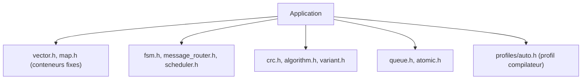

# ETLCPP/etl

> Bibliothèque C++ d'en-têtes à conteneurs de taille fixe, sans allocation dynamique, pour systèmes embarqués.

## Le problème
Les conteneurs de la STL allouent sur le tas, ce qui est déconseillé ou interdit sur microcontrôleur.

## Ce que ça fait vraiment
Des conteneurs à capacité fixée à la compilation avec une API proche de la STL, plus des utilitaires : machines à états, routage de messages, planificateur, timers, CRC, variants. Compatible C++03 et plus, avec des fonctions de C++11 et suivants rétroportées. Plus de 10 000 tests unitaires annoncés.

## Comment c'est branché


## Essayer
```bash
git clone https://github.com/ETLCPP/etl.git
cd etl
git checkout <targetVersion>
cmake -B build .
cmake --install build/
```

## Coût et pièges
Gratuit, MIT. Certaines interfaces sont à implémenter par projet (horloges de `chrono.h`, `etl_putchar` pour `print.h`). Un fichier `etl_profile.h` ajuste la bibliothèque.

## Ce que ce n'est pas
Pas un remplacement complet de la STL. Ne sert pas en data science ni en MLOps classique ; l'auteur cherche des testeurs Keil, IAR et DSP.

## Alternatives
Non documenté dans le README, qui se positionne seulement face à la STL.

## Pour toi
À surveiller : hors sujet pour du Python data, mais utile si tu portes de l'inférence ou du traitement du signal sur microcontrôleur.

