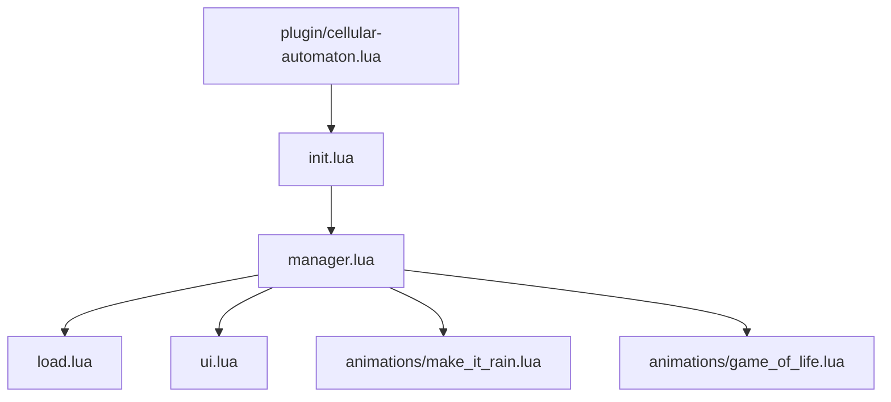

# Eandrju/cellular-automaton.nvim

> Neovim plugin that animates the buffer content as a cellular automaton, just for fun.

## The problem
No practical problem: the author presents it as useless and meant for procrastination.

## What it actually does
Launches animations (make_it_rain, game_of_life, scramble) from the buffer text. Each cell carries a character and a treesitter highlight group. You can register your own animation with an update function.

## How it is wired


## Trying it
```bash
:CellularAutomaton make_it_rain
:CellularAutomaton game_of_life
```

## Cost and gotchas
Requires Neovim 0.9 and a treesitter parser. Folding and line wrapping are not handled.

## What it is not
Not a productivity tool nor a scientific visualization tool.

## Alternatives
No alternative named in the README.

## For you
Ignore: amusing gadget, no value for your work, and no commit since early 2025.
