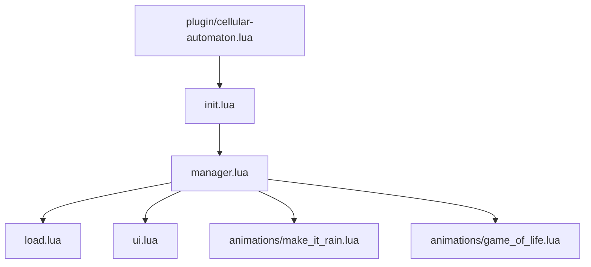

# Eandrju/cellular-automaton.nvim

> Plugin Neovim qui anime le contenu du buffer en automate cellulaire, pour le plaisir.

## Le problème
Aucun problème pratique : l'auteur le présente comme inutile et destiné à la procrastination.

## Ce que ça fait vraiment
Lance des animations (make_it_rain, game_of_life, scramble) à partir du texte du buffer. Chaque cellule porte un caractère et un groupe de surbrillance treesitter. On peut enregistrer sa propre animation avec une fonction update.

## Comment c'est branché


## Essayer
```bash
:CellularAutomaton make_it_rain
:CellularAutomaton game_of_life
```

## Coût et pièges
Neovim 0.9 et un parser treesitter requis. Pliage et retour à la ligne non gérés.

## Ce que ce n'est pas
Pas un outil de productivité ni de visualisation scientifique.

## Alternatives
Aucune alternative nommée dans le README.

## Pour toi
Ignorer : gadget amusant, sans valeur pour ton travail, et sans commit depuis début 2025.

