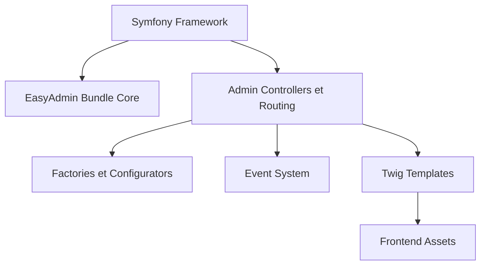

# EasyCorp/EasyAdminBundle

> Symfony bundle that generates administration interfaces from Doctrine entities.

## The problem
Building a back office (list, edit, filters, permissions) on Doctrine entities is repetitive.

## What it actually does
A command generates a dashboard and CRUDs from the entities. It provides search, filters, pagination, over 30 field types, form layouts, custom actions, fine-grained security, translations and light/dark themes. Controllers use factories, configurators and events, with Twig templates. A paid Pro version exists.

## How it is wired
Diagram based on the one provided.



## Trying it
```bash
composer require easycorp/easyadmin-bundle
php bin/console make:admin:dashboard
php bin/console make:admin:crud
```

## Cost and gotchas
Free (MIT); EasyAdmin Pro adds paid features (audit, content lock). PHP 8.2+, Symfony 6.4+ and Doctrine entities.

## What it is not
Not a standalone framework: it only works inside a Symfony application with Doctrine ORM. The 3.x branch and older ones are no longer maintained.

## Alternatives
No alternative named in the README.

## For you
Ignore: only useful for a Symfony back office, outside your data/AI scope.
