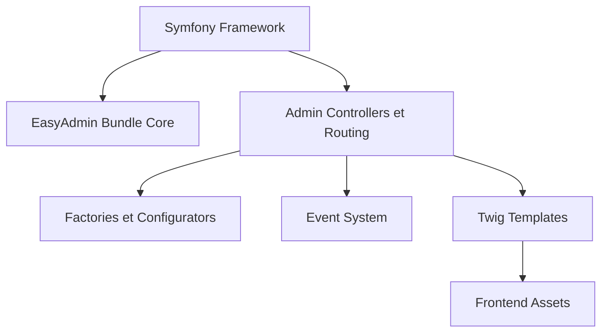

# EasyCorp/EasyAdminBundle

> Bundle Symfony qui génère des interfaces d'administration à partir des entités Doctrine.

## Le problème
Construire un back-office (liste, édition, filtres, droits) sur des entités Doctrine est répétitif.

## Ce que ça fait vraiment
Une commande génère un tableau de bord et des CRUD à partir des entités. Il apporte recherche, filtres, pagination, plus de 30 types de champs, mises en page de formulaires, actions personnalisées, sécurité fine, traductions et thèmes clair/sombre. Les contrôleurs utilisent des fabriques, des configurateurs et des événements, avec des templates Twig. Une version Pro payante existe.

## Comment c'est branché
Schéma d'après le diagramme fourni.



## Essayer
```bash
composer require easycorp/easyadmin-bundle
php bin/console make:admin:dashboard
php bin/console make:admin:crud
```

## Coût et pièges
Gratuit (MIT) ; EasyAdmin Pro ajoute des fonctions payantes (audit, verrou de contenu). PHP 8.2+, Symfony 6.4+ et des entités Doctrine.

## Ce que ce n'est pas
Pas un framework autonome : il ne marche que dans une application Symfony avec Doctrine ORM. La branche 3.x et les plus anciennes ne sont plus maintenues.

## Alternatives
Aucune alternative nommée dans le README.

## Pour toi
À ignorer : utile seulement pour un back-office Symfony, hors de ton périmètre data/IA.

