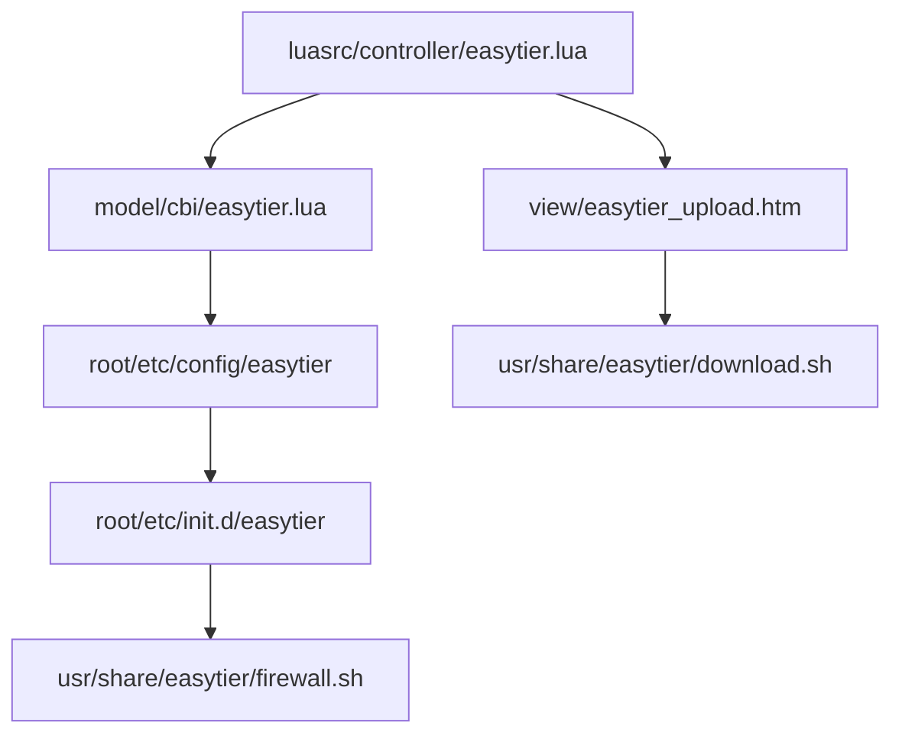

# EasyTier/luci-app-easytier

> LuCI interface to manage EasyTier, a decentralized mesh VPN, on OpenWrt routers.

## The problem
EasyTier is driven from the command line; on an OpenWrt router, you want a web settings page.

## What it actually does
The Lua controller routes to the configuration page, the status (traffic, version), the logs and the upload of the EasyTier binary. The UCI configuration feeds an init.d script that launches EasyTier and applies the firewall rules. Configuration through a config.toml file is also possible.

## How it is wired


## Trying it
```bash
opkg install /tmp/luci-app-easytier_*.ipk
apk add --allow-untrusted /tmp/luci-app-easytier_*.apk
opkg update
opkg install kmod-tun
```

## Cost and gotchas
Free. You need an OpenWrt router, the kmod-tun module and luci-compat, then upload the EasyTier binary. The `--allow-untrusted` option disables signature verification of the APK package.

## What it is not
Not the VPN itself: only its web interface. Not made for a regular Linux server.

## Alternatives
No alternative cited in the README (the official EasyTier repository is linked as the base project).

## For you
Ignore: home networking on OpenWrt, unrelated to data, AI or MLOps work.
