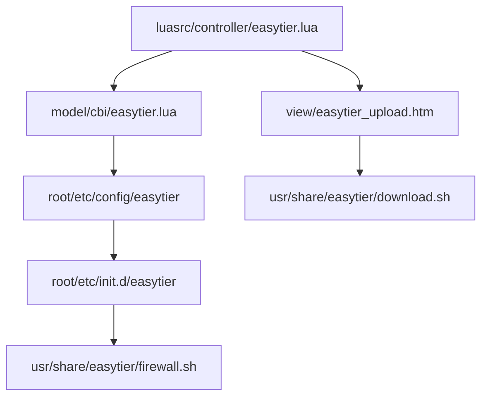

# EasyTier/luci-app-easytier

> Interface LuCI pour gérer EasyTier, un VPN maillé décentralisé, sur routeurs OpenWrt.

## Le problème
EasyTier se pilote en ligne de commande ; sur un routeur OpenWrt, on veut une page web de réglage.

## Ce que ça fait vraiment
Le contrôleur Lua route vers la page de configuration, l'état (trafic, version), les journaux et l'envoi du binaire EasyTier. La configuration UCI alimente un script init.d qui lance EasyTier et applique les règles de pare-feu. Une configuration par fichier config.toml est aussi possible.

## Comment c'est branché


## Essayer
```bash
opkg install /tmp/luci-app-easytier_*.ipk
apk add --allow-untrusted /tmp/luci-app-easytier_*.apk
opkg update
opkg install kmod-tun
```

## Coût et pièges
Gratuit. Il faut un routeur OpenWrt, le module kmod-tun et luci-compat, puis téléverser le binaire EasyTier. L'option `--allow-untrusted` désactive la vérification de signature du paquet APK.

## Ce que ce n'est pas
Pas le VPN lui-même : seulement son interface web. Pas fait pour un serveur Linux classique.

## Alternatives
Aucune alternative citée dans le README (le dépôt EasyTier officiel est lié comme projet de base).

## Pour toi
Ignorer : réseau domestique sous OpenWrt, sans rapport avec un travail data, IA ou MLOps.

