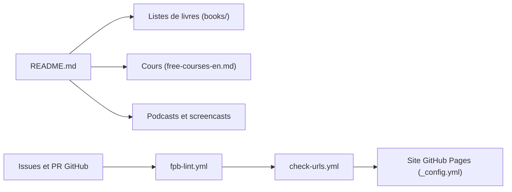

# EbookFoundation/free-programming-books

> Collaborative list of free books, courses, podcasts and cheat sheets, sorted by language, for learners.

## The problem
Good free resources for learning to programme are scattered across the web, in dozens of languages, and go stale quickly. Without an up-to-date list, you end up on dead links or paid content in disguise.

## What it actually does
These are Markdown files of links, organised by type (books, courses, podcasts/screencasts, cheat sheets, problem sets) and then by language. English-language books have two indexes: by language and by subject. Nothing runs: the repository contains no database and no application. Three GitHub Actions workflows check the URLs, the format and the writing direction (RTL/LTR) of contributions.

## How it is wired

## Trying it
No command is documented in the README: the list is browsed on the repository or on the static site, and a dedicated search exists at ebookfoundation.github.io/free-programming-books-search/.

## Cost and gotchas
Free, nothing to create. The links point to third-party sites whose content is not guaranteed by the repository; half of the content is in languages other than English.

## What it is not
It is not a learning path: no reading order, no quality assessment beyond curation. The search is a separate service, hosted outside this repository.

## Alternatives
No alternative named in the README.

## For you
Worth watching as an occasional address book (free books and courses): useful for filling a gap, but with no dedicated data/AI section, so not a daily working tool.
