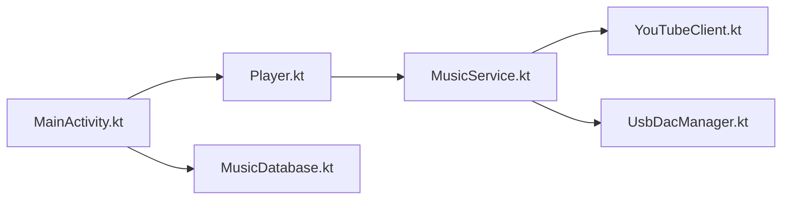

# EchoMusicApp/Echo-Music

> Android player for YouTube Music without ads, with downloads, synced lyrics and song recognition.

## The problem
Listening to YouTube Music on mobile forces ads and restricted features outside a subscription.

## What it actually does
Android client that queries the YouTube Music APIs and displays them in a custom interface: background playback, offline mode, crossfade, word-by-word lyrics, AI translation via an API key, music recognition, USB DAC output. The repository dates from August 2026.

## How it is wired


## Trying it
```bash
git clone https://github.com/EchoMusicApp/Echo-Music.git
cd Echo-Music
./gradlew assembleUniversalGmsDebug
```

## Cost and gotchas
Free. Firebase is required for analytics and crash reports in the build. OTA updates were removed: manual update from a site with a few ads.

## What it is not
Not a music host: everything comes from YouTube, whose terms of use apply. The README leaves legal responsibility to the user.

## Alternatives
No alternative named in the README.

## For you
Ignore: leisure use, legal risk tied to YouTube's terms, unrelated to data/AI.
