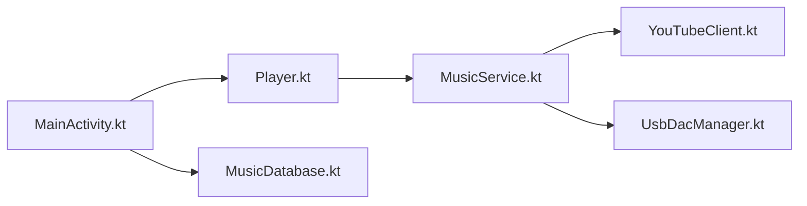

# EchoMusicApp/Echo-Music

> Lecteur Android pour YouTube Music sans publicité, avec téléchargements, paroles synchronisées et reconnaissance de titres.

## Le problème
Écouter YouTube Music sur mobile impose publicités et fonctions bridées hors abonnement.

## Ce que ça fait vraiment
Client Android qui interroge les API de YouTube Music et les affiche dans une interface personnalisée : lecture en arrière-plan, mode hors ligne, crossfade, paroles mot à mot, traduction par IA via une clé API, reconnaissance de musique, sortie USB DAC. Le dépôt date d'août 2026.

## Comment c'est branché


## Essayer
```bash
git clone https://github.com/EchoMusicApp/Echo-Music.git
cd Echo-Music
./gradlew assembleUniversalGmsDebug
```

## Coût et pièges
Gratuit. Firebase est requis pour l'analytique et les rapports de crash dans la compilation. Les mises à jour OTA ont été retirées : mise à jour manuelle depuis un site avec quelques publicités.

## Ce que ce n'est pas
Pas un hébergeur de musique : tout vient de YouTube, dont les conditions d'utilisation s'appliquent. Le README renvoie la responsabilité légale à l'utilisateur.

## Alternatives
Aucune alternative nommée dans le README.

## Pour toi
Ignorer : usage de loisir, risque juridique lié aux conditions de YouTube, sans lien avec data/IA.

