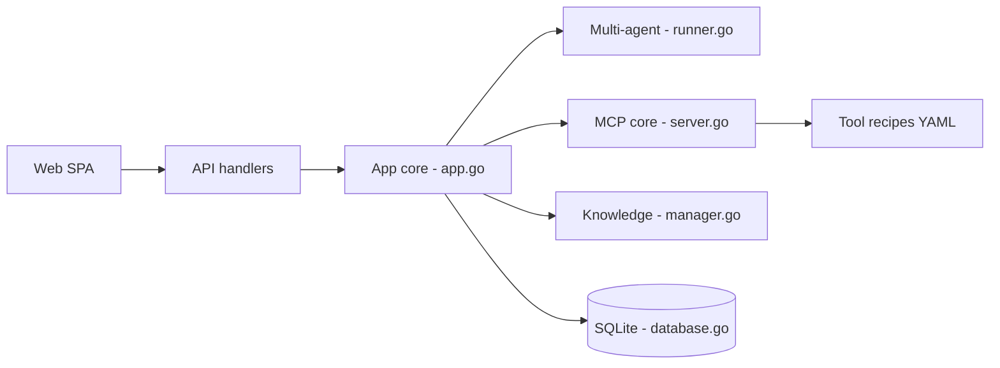

# Ed1s0nZ/CyberStrikeAI

> LLM-driven Go platform that orchestrates penetration-testing tools, for authorized security teams.

## The problem
A penetration test chains dozens of command-line tools, whose outputs have to be driven, decisions traced and findings recorded by hand.

## What it actually does
- A Go server with a web interface: a natural-language request becomes a sequence of tool calls (YAML recipes, over 100), executed through an MCP layer.
- Single-agent and multi-agent modes (Deep, Plan-Execute, Supervisor), roles, skills and graph workflows, with human validation and an audit log.
- Stores conversations, vulnerabilities, assets and attack chains in SQLite; knowledge base with vector search.
- Dual-use modules (WebShell management, built-in C2), reserved for systems you own or for which you have written authorization.

## How it is wired


## Trying it
```bash
git clone https://github.com/Ed1s0nZ/CyberStrikeAI.git
cd CyberStrikeAI
chmod +x run.sh && ./run.sh
# ou : ./run.sh --http
# puis configurer un canal IA dans Paramètres système (clé d'API, URL, modèle)
```

## Cost and gotchas
Requires Go 1.25+, Python 3.10+ and an API key from an OpenAI-compatible provider, billed to you. The security tools must be installed separately; the initial admin password is displayed only once at first startup.

## What it is not
Not a tool to run against arbitrary targets: use requires explicit authorization, on pain of prosecution. The license is not declared in the catalog: reuse and redistribution are uncertain. The configuration must be hardened before any exposure beyond localhost.

## Alternatives
- The Burp Suite plugin shipped in the repository, if you want to stay in your usual interception proxy.
- The individual tools mentioned (nmap, nuclei, sqlmap, metasploit) used directly, if you do not need the agent layer.

## For you
Worth watching: the MCP orchestration, RBAC and audit of tool calls is instructive for an AI/MLOps profile, but the undeclared license, the single maintainer and the offensive scope make it a tool for security specialists.
