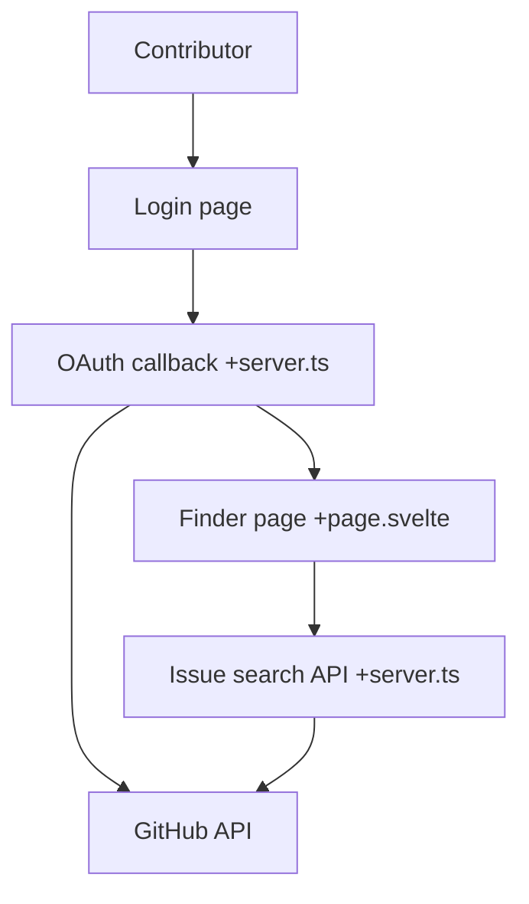

# EddieHubCommunity/good-first-issue-finder

> SvelteKit site helping new open source contributors find "good first issues" on GitHub.

## The problem
Beginners do not know where to find accessible issues for a first contribution.

## What it actually does
SvelteKit web application: GitHub OAuth login, issue search through GitHub's GraphQL API, filters, issue cards and repository details. The authentication cookie is confirmed in the sampled code; the exact link between the interface and the search API is not established. End-to-end tests run with Playwright.

## How it is wired



## Trying it
```bash
git clone https://github.com/YOUR_USERNAME/good-first-issue-finder.git
cd good-first-issue-finder
npm install
npm run dev
npx playwright install --with-deps
```

## Cost and gotchas
Free. You must create a GitHub OAuth App (not a GitHub App) and fill in a `.env` file, with a callback to `http://localhost:5173/api/authentication/callback`. Repository archived.

## What it is not
Not a maintained tool: the repository is archived with no commits since August 2024. Not a recommendation engine, just an issue search.

## Alternatives
No alternative named in the README.

## For you
Ignore: archived and centered on open source contribution, no value for a data/AI/MLOps profile.
