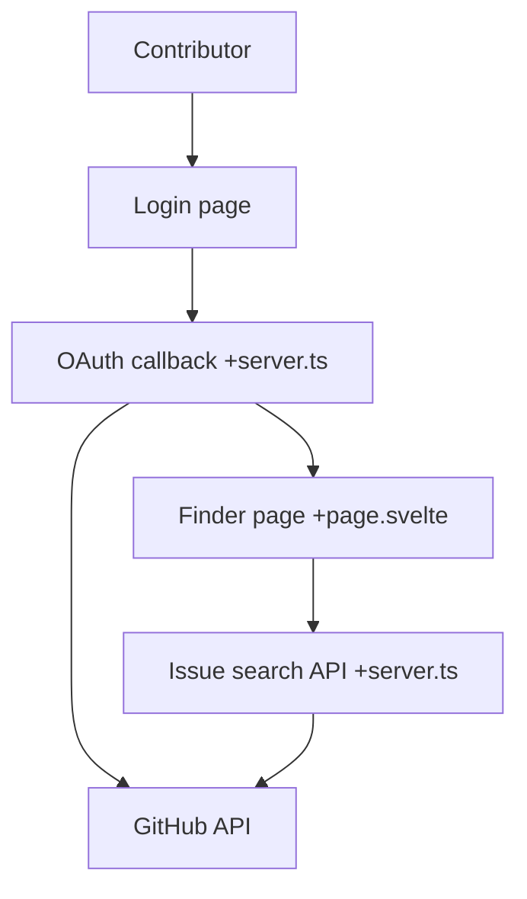

# EddieHubCommunity/good-first-issue-finder

> Site SvelteKit aidant les nouveaux contributeurs open source à trouver des « good first issues » sur GitHub.

## Le problème
Les débutants ne savent pas où trouver des tickets accessibles pour une première contribution.

## Ce que ça fait vraiment
Application web SvelteKit : connexion par OAuth GitHub, recherche d'issues via l'API GraphQL de GitHub, filtres, cartes d'issues et détail des dépôts. Le cookie d'authentification est confirmé dans le code échantillonné ; le lien exact entre l'interface et l'API de recherche n'est pas établi. Des tests de bout en bout tournent avec Playwright.

## Comment c'est branché



## Essayer
```bash
git clone https://github.com/YOUR_USERNAME/good-first-issue-finder.git
cd good-first-issue-finder
npm install
npm run dev
npx playwright install --with-deps
```

## Coût et pièges
Gratuit. Il faut créer une OAuth App GitHub (pas une GitHub App) et renseigner un fichier `.env`, avec un callback vers `http://localhost:5173/api/authentication/callback`. Dépôt archivé.

## Ce que ce n'est pas
Pas un outil maintenu : le dépôt est archivé et sans commit depuis août 2024. Ce n'est pas un moteur de recommandation, juste une recherche d'issues.

## Alternatives
Aucune alternative nommée dans le README.

## Pour toi
À ignorer : archivé et centré sur la contribution open source, sans valeur pour un profil data/IA/MLOps.

