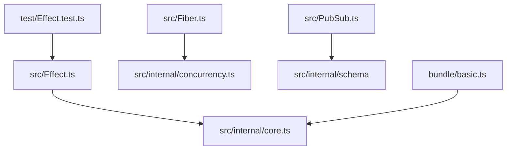

# Effect-TS/effect-smol

> Former repository of Effect version 4, moved to the Effect-TS/effect repository, for TypeScript developers.

## The problem
Development of Effect v4 (functional and concurrent programming in TypeScript) has been merged into the main repository.

## What it actually does
The README contains only a moving notice: the v4 history is merged into Effect-TS/effect (v4 on main, v3 on the v3 branch), and a v3-to-v4 migration guide exists. According to the file tree, the library offers Effect, Fiber, Queue, PubSub and Schedule.

## How it is wired

## Trying it
No command documented: the README asks not to open an issue or pull request here.

## Cost and gotchas
Free. The README declares itself archived and read-only while the catalog shows a non-archived repository, with last push in July 2026: rely on the README and contribute nothing here. The provided diagram is a description generated from the tree, to be taken with caution.

## What it is not
Not the active Effect repository: do not look here for new features or fixes.

## Alternatives
Effect-TS/effect, the canonical repository cited in the README.

## For you
Ignore: transition repository; follow Effect-TS/effect instead, which is also a TypeScript choice and not Python.
