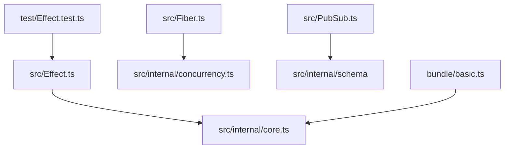

# Effect-TS/effect-smol

> Ancien dépôt de la version 4 d'Effect, déménagé vers le dépôt Effect-TS/effect, pour développeurs TypeScript.

## Le problème
Le développement de la v4 d'Effect (programmation fonctionnelle et concurrente en TypeScript) a été fusionné dans le dépôt principal.

## Ce que ça fait vraiment
Le README ne contient qu'un avis de déménagement : l'historique de la v4 est fusionné dans Effect-TS/effect (v4 sur main, v3 sur la branche v3), et un guide de migration de la v3 vers la v4 existe. D'après l'arbre des fichiers, la bibliothèque propose Effect, Fiber, Queue, PubSub et Schedule.

## Comment c'est branché

## Essayer
Aucune commande documentée : le README demande de ne pas ouvrir d'issue ni de pull request ici.

## Coût et pièges
Gratuit. Le README se déclare archivé et en lecture seule alors que le catalogue indique un dépôt non archivé, avec dernier push en juillet 2026 : se fier au README pour ne rien y contribuer. Le schéma fourni est une description générée d'après l'arbre, à prendre avec réserve.

## Ce que ce n'est pas
Pas le dépôt actif d'Effect : ne pas y chercher de nouveautés ni de correctifs.

## Alternatives
Effect-TS/effect, dépôt canonique cité dans le README.

## Pour toi
Ignorer : dépôt de transition ; suis plutôt Effect-TS/effect, qui est aussi un choix TypeScript et non Python.

