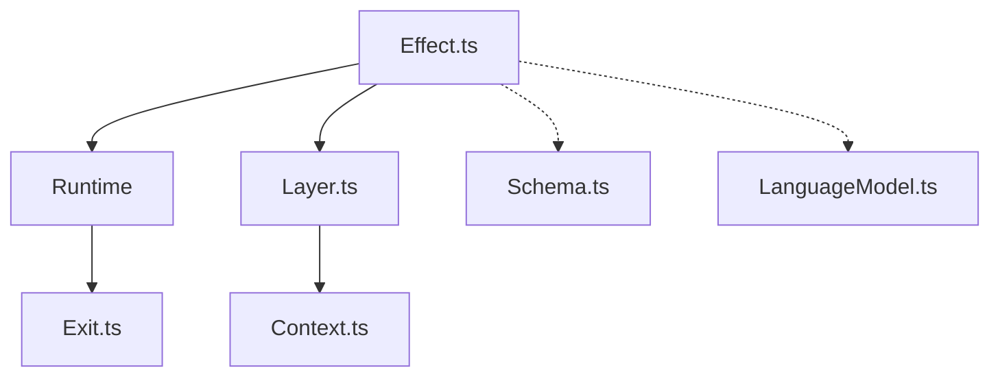

# Effect-TS/effect

> TypeScript library for typed errors, dependency injection and structured concurrency, for building robust applications.

## The problem
TypeScript applications lose track of errors, resources and dependencies as they grow.

## What it actually does
An `effect` core: you compose an Effect program, provide its services through Layers, run it with the runtime and read an Exit result. On top of that come fibers, scopes, scheduling, validation schemas, streams, an HTTP API, AI modules and cluster. Integration packages cover platforms (Node, Bun, Deno, browser), SQL clients, AI providers (Anthropic, OpenAI, OpenRouter), OpenTelemetry and Vitest.

## How it is wired


## Trying it
```bash
npm install effect
```

## Cost and gotchas
Free. Requires TypeScript 5.9+, Node.js 22.19+ and `strict` mode. Effect 4.x is an LTS version; plan for migration from 3.x.

## What it is not
Not a simple utility: it is a programming model of its own. The repository provides no AI model, only abstractions.

## Alternatives
No alternative is named in the README.

## For you
Watch: worth knowing if you build TypeScript backends around LLM calls; otherwise the learning curve is not justified.
