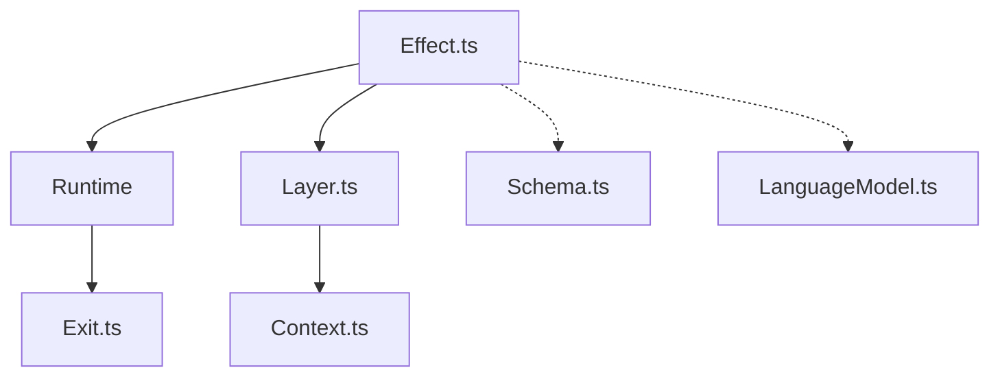

# Effect-TS/effect

> Bibliothèque TypeScript d'erreurs typées, injection de dépendances et concurrence structurée pour applications robustes.

## Le problème
Les applications TypeScript perdent la trace des erreurs, des ressources et des dépendances quand elles grossissent.

## Ce que ça fait vraiment
Un noyau `effect` : on compose un programme Effect, on fournit ses services par des Layers, on l'exécute avec le runtime et on lit un résultat Exit. S'y ajoutent fibres, scopes, planification, schémas de validation, flux, API HTTP, modules IA et cluster. Des paquets d'intégration couvrent plateformes (Node, Bun, Deno, navigateur), clients SQL, fournisseurs IA (Anthropic, OpenAI, OpenRouter), OpenTelemetry et Vitest.

## Comment c'est branché


## Essayer
```bash
npm install effect
```

## Coût et pièges
Gratuit. Exige TypeScript 5.9+, Node.js 22.19+ et le mode `strict`. Effect 4.x est une version LTS ; la migration depuis la 3.x est à prévoir.

## Ce que ce n'est pas
Pas un simple utilitaire : c'est un modèle de programmation à part. Le dépôt ne fournit pas de modèle d'IA, seulement des abstractions.

## Alternatives
Aucune alternative nommée dans le README.

## Pour toi
Surveiller : à connaître si tu bâtis des backends TypeScript autour d'appels de LLM, sinon la courbe d'apprentissage ne se justifie pas.

